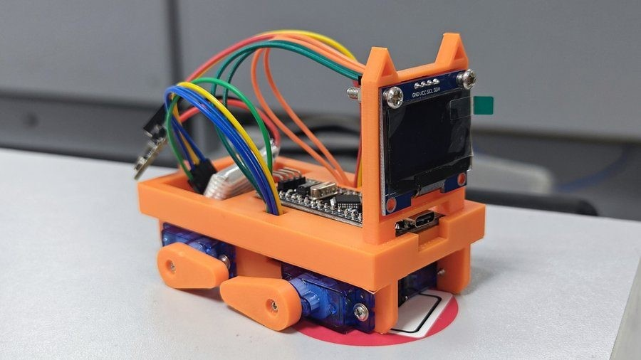
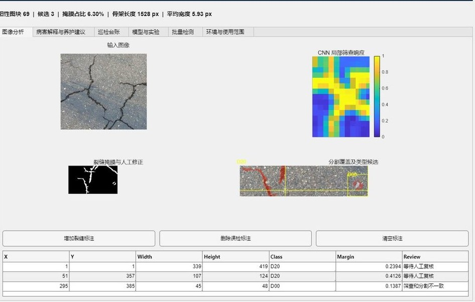

# 孙靖凯 · 电子信息工程作品集

我做过桌面机器人的舵机和显示适配，也把摄像头前的手势变成过屏幕上可以看到的动作。在机器学习课设里，我更关心另一个问题：模型换一批图还能不能用？下面三条线分别记录这些项目怎样做出来，以及我怎样检查结果。

| [桌面机器人的四次迭代](projects/desktop-robot-evolution/) | [光纤通信课设 · 机器学习](collections/ml/) | [数字图像处理与摄像头识别](collections/imaging/) |
| --- | --- | --- |
|  |  |  |
| 从 STM32 的动作和表情，到 PowerPet 显示 UPS 状态，再到 ESP32-C3 与 ESP32-S3 毕设的联网、语音和屏幕交互。 | 从一张路面照片开始，看我如何划分数据、比较模型、定位误差。九项实验覆盖分类、检测、分割、回归和通信均衡。 | 同一专题里可以看到摄像头采集的手势如何驱动 Three.js 场景，以及暗光增强、去雾、复原和水印实验怎样评价效果。 |

## CAD 制图与 SolidWorks 建模

我做过滨水空间的 CAD 总平面图，也为饮水机设计了换桶辅助结构。专题中可以下载四份二维 DWG，或打开带孔支座的三维模型，对照草图检查孔径、孔距和外形尺寸。[图纸与可旋转模型](collections/mechanical/)

## 其他工程作品

| 项目 | 我做了什么 |
| --- | --- |
| [灵眸云控 · 四足巡检机器人](projects/quadruped-robot/) | 绘制双层主控板，参与八路舵机标定和整机联调。可看装配模型与拆盖照片。 |
| [无碍智饮 · 无障碍饮水机](projects/accessible-water-dispenser/) | 参与双模取水控制，独立设计换桶辅助装置。可对照控制框图、机构附图和会议论文。 |
| [路畅 · 双向交通灯](projects/trafficlight-controller/) | 独立编写 Arduino Uno 固件。项目页有模式切换实拍、引脚表和可编译的草图。 |
| [电子电路与测试](collections/electronics/) | 从信号发生器的焊接板到示波器上的三角波，记录装配、调试与测量。 |
| [题库工坊与软件工具](collections/software/) | 将 Word 题库整理成可核对、可计分的离线练习工具，附解析引擎、截图和自动化测试。 |

[嵌入式实践与其他设备照片](collections/embedded/) · [照片转拼豆图纸与备料示例](projects/bead-pattern-generator/)
