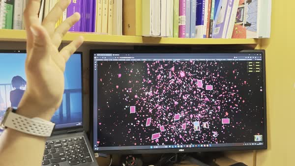

# 孙靖凯 · 电子信息工程作品集

我是孙靖凯，电子信息工程专业。我做视觉检测时会把错判的样本留下来，做硬件时也会保存装配照片和实测波形。这里整理了从数据和电路图到实验结果的过程，项目页可以直接查看代码、图纸和运行画面。

## 按能力看作品

| 想了解的能力 | 从哪件作品开始 |
| --- | --- |
| 视觉算法与实验设计 | [道路裂缝检测](projects/road-crack-detection/)比较 CNN 与传统特征在内外部样本上的差异。[焊丝计数](projects/weld-wire-counter/)把模型导出为 ONNX，在 CPU 上逐图核对检测框和根数。 |
| 图像处理与实时交互 | [场景去雾](projects/adaptive-dehazing/)用清晰参考图评估恢复效果。[摄像头手势](projects/camera-hand-interaction/)有连续实录，可以看到手部动作如何改变粒子。 |
| 嵌入式与板级调试 | [STM32 → PowerPet → ESP32-C3 → ESP32-S3](projects/desktop-robot-evolution/)记录从驱动舵机到联网语音交互的演变。[四足机器人](projects/quadruped-robot/)展示双层 PCB、装机和八路舵机标定。[电子实物](collections/electronics/)收录焊接板与示波器实拍。 |
| 机械制图与结构设计 | [CAD 与 SolidWorks](collections/mechanical/)可以下载 DWG、查看三维模型。[换桶装置](projects/accessible-water-dispenser/)可以沿着申请附图理解螺杆和托板的运动。 |
| 文献阅读与技术写作 | [无障碍饮水机会议论文及实用新型申请文件](projects/accessible-water-dispenser/#论文与专利申请文件)分别记录团队论文中的分工和我的结构设计。[11 份传感器设计](collections/sensing/#十一个传感器设计)附选型、计算和参考资料。 |
| 项目整理与可复现性 | [裂缝指标复算脚本](projects/road-crack-detection/verify_results.m)能从原始计数复算 F1 和 IoU。[仓库维护约定](docs/project-standard.md)和[自动检查](.github/workflows/verify.yml)记录项目怎样归档、验证链接、测试程序和编译固件。 |

## 三条项目主线

| [桌面机器人的四次迭代](projects/desktop-robot-evolution/) | [机器学习 · 从道路裂缝检测开始](collections/ml/) | [数字图像处理与摄像头识别](collections/imaging/) |
| --- | --- | --- |
|  |  |  |
| 从 STM32 的动作和表情，到 PowerPet 显示 UPS 状态，再到 ESP32-C3 与 ESP32-S3 毕设的联网、语音和屏幕交互。 | 从一张路面照片开始，看我如何划分数据、比较模型、定位误差。九项实验覆盖分类、检测、分割、回归和通信均衡。 | 同一专题里可以看到摄像头采集的手势如何驱动 Three.js 场景，以及暗光增强、去雾、复原和水印实验怎样评价效果。 |

## CAD 制图与 SolidWorks 建模

我做过滨水空间的 CAD 总平面图，也为饮水机设计了换桶辅助结构。专题中可以下载四份二维 DWG，或打开带孔支座的三维模型，对照草图检查孔径、孔距和外形尺寸。[图纸与可旋转模型](collections/mechanical/)

## 从传感器输入到波形测量

做桌宠时，我用 PWM 控制舵机；装调示波器时，我从屏幕反过来读信号。两者之间还有温度读取、定时器捕获、数字钟和模拟信号发生器。另外整理了 11 个传感器设计，每个都可以打开电路原图和计算正文。沿着采样、控制和测量看，可以把开发板练习、电路图和实物波形对应起来。[信号怎样被采集、处理和观察](collections/sensing/)

## 其他工程作品

| 项目 | 我做了什么 |
| --- | --- |
| [灵眸云控 · 四足巡检机器人](projects/quadruped-robot/) | 绘制双层主控板，参与八路舵机标定和整机联调。可看装配模型与拆盖照片。 |
| [无碍智饮 · 无障碍饮水机](projects/accessible-water-dispenser/) | 参与双模取水控制，独立设计换桶辅助装置。可对照控制框图、机构附图和会议论文。 |
| [路畅 · 双向交通灯](projects/trafficlight-controller/) | 独立编写 Arduino Uno 固件。项目页有模式切换实拍、引脚表和可编译的草图。 |
| [电子实物作品设计、焊接与调试](collections/electronics/) | 从数字钟的计数电路、信号发生器的焊接板，到示波器实测的三角波，可对照电路图、元件布局和通电结果。 |
| [离线题库工坊](projects/quiz-bank-workshop/) | 将 Word 题库整理成可核对、可计分的离线练习工具，附解析引擎、截图和自动化测试。 |
| [毕业生就业信息管理系统](projects/graduate-information-system/) | 单页完成就业记录的录入、筛选和修改，可导入表格，导出 Excel 或 PDF。公开版从空表开始。 |

[嵌入式实践与其他设备照片](collections/embedded/) · [照片转拼豆图纸与备料示例](projects/bead-pattern-generator/) · [软件工具总览](collections/software/)

### 网页互动与桌面绘图

[手势粒子树与现场实录](projects/camera-hand-interaction/) · [可下载的祝福便签网页](collections/software/details/notes-web.md) · [桌面绘图作品索引](collections/software/details/python-utilities.md)

展开全部娱乐作品，点击名称直接看运行画面

| 作品类型 | 点击作品名查看运行画面 |
| --- | --- |
| 网页互动与节日动画 | [跨年粒子字](collections/software/details/new-year.md) · [像素爱心](collections/software/details/pixel-heart.md) · [祝福便签（网页）](collections/software/details/notes-web.md) · [飘雪贺卡](collections/software/details/holiday-card.md) · [圣诞夜景](collections/software/details/christmas-scene.md) · [线条圣诞树](collections/software/details/outline-tree.md) · [手势粒子树](collections/software/details/gesture-tree.md) · [爱心树计时器](collections/software/details/elapsed-time.md) |
| 桌面绘图与小动画 | [中秋月夜](collections/software/details/mid-autumn.md) · [四叶草](collections/software/details/clover-drawing.md) · [树叶](collections/software/details/leaf.md) · [樱花树](collections/software/details/cherry-tree.md) · [爱心散落](collections/software/details/scattered-hearts.md) · [生日蛋糕](collections/software/details/cake.md) · [祝福便签（桌面）](collections/software/details/notes-desktop.md) |
| 角色绘图与像素画 | [Loopy](collections/software/details/loopy.md) · [像素维纳斯](collections/software/details/venus.md) · [像素草莓熊](collections/software/details/pixel-bear.md) · [草莓熊与玫瑰](collections/software/details/bear-rose.md) · [线条小狗](collections/software/details/dog.md) · [小猪佩奇](collections/software/details/peppa.md) · [库洛米](collections/software/details/kuromi.md) · [星之卡比](collections/software/details/kirby.md) · [篮球人物](collections/software/details/basketball.md) · [爱心小兔](collections/software/details/heart-rabbit.md) · [皮卡丘](collections/software/details/pikachu.md) · [小帕](collections/software/details/puppy-portrait.md) · [蜘蛛侠](collections/software/details/spider.md) · [蜡笔小新](collections/software/details/shin-chan.md) · [路飞线稿](collections/software/details/luffy.md) · [电影人物剪影](collections/software/details/leon.md) · [钢铁侠面罩](collections/software/details/iron-man.md) · [黑白马里奥](collections/software/details/mario.md) |
| 桌面圣诞树系列 | [圣诞树 1](collections/software/details/desktop-tree-1.md) · [圣诞树 2](collections/software/details/desktop-tree-2.md) · [圣诞树 3](collections/software/details/desktop-tree-3.md) · [圣诞树 4](collections/software/details/desktop-tree-4.md) · [圣诞树 5](collections/software/details/desktop-tree-5.md) · [圣诞树 6](collections/software/details/desktop-tree-6.md) · [圣诞树 7](collections/software/details/desktop-tree-7.md) |

