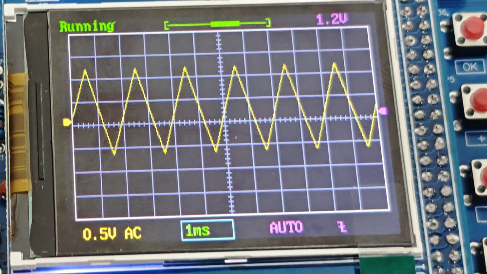
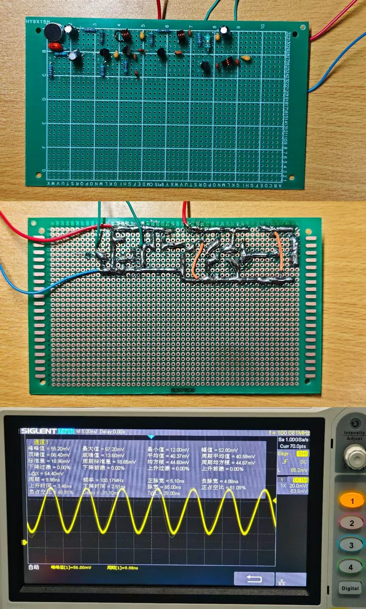
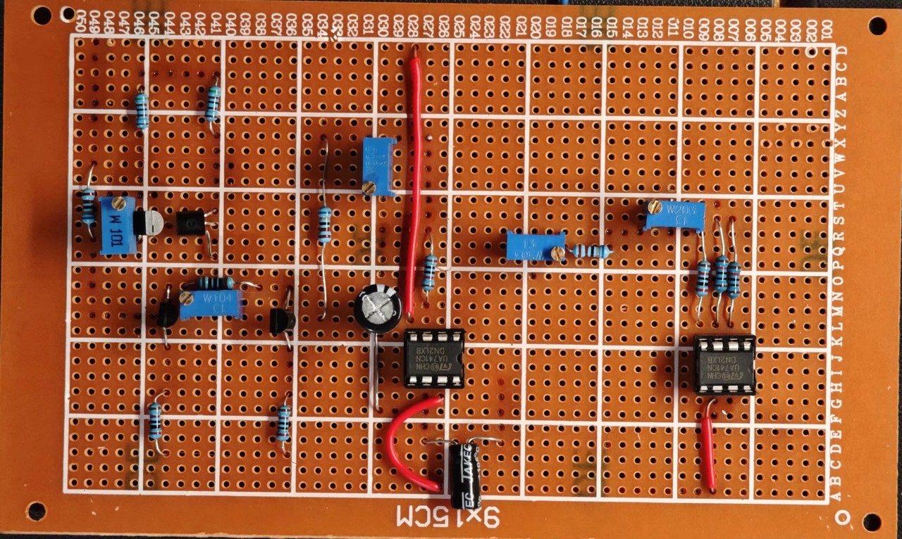
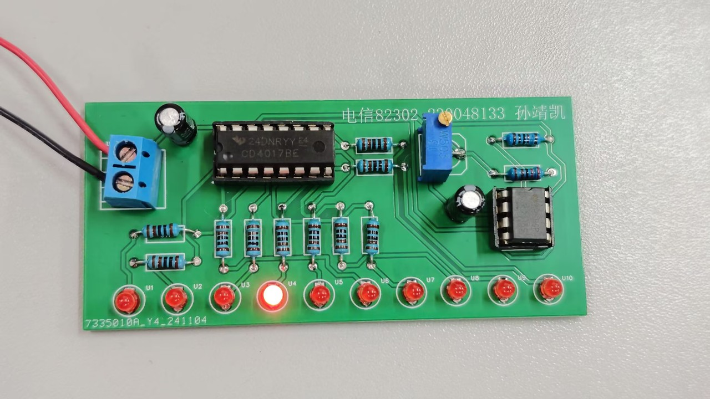
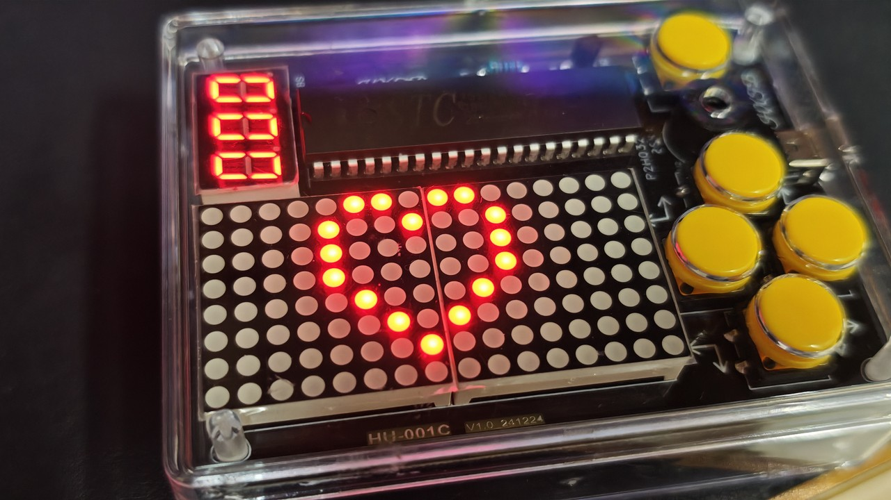
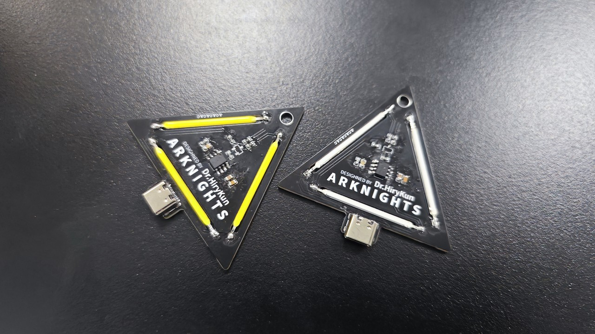

# 电子实物作品设计、焊接与调试

从图纸到通电，我留下了三类记录：数字钟的电路与仿真波形、洞洞板和套件的焊接照片，以及示波器采到的三角波。下面可以按电路设计、实物装配或信号测量查看。

## [便携式数字示波器](details/digital-oscilloscope-kit.md)

我焊接并调试了示波器套件。板上的模拟前端接入信号，经 ADC 采样后送到 TFT 显示。下图是装调时留下的三角波画面，屏幕可读出交流耦合和 1 ms 时基。

## [FM 无线传声器](details/fm-transmitter-lab.md)

我把拾音和振荡电路装在一块洞洞板上。这组三联照保留了元件位置、焊接走线和调试波形。[查看装调实拍大图](details/fm-transmitter-lab.md)

## 电路与板级练习

| 实践 | 我动手做的部分 |
| --- | --- |
| [模拟信号发生器](details/signal-generator-lab.md)、[FM 无线传声器](details/fm-transmitter-lab.md) | 围绕运放波形生成和调频振荡做电路装配、焊接与调试。 |
| [数字电子钟](details/digital-clock-lab.md) | 用 CD4029 计数器做计时与报时电路。 |
| [触控调光灯](details/touch-led-lamp.md)、[焊接套件](details/soldering-kits.md) | 对照参考方案装配和调试，练习焊接与返修。 |
| [PCB 绘制](details/pcb-design-lab.md) | 从原理图、布板练习走到实际装机的双层板。[四足机器人主控板与接线](../../projects/quadruped-robot/assets/assembly.jpg) |

## 从焊接板到显示结果

| 模拟信号发生器的焊接板 | 流水灯电路板 |
| --- | --- |
|  |  |

左图记录了信号发生器的装配，能看到运放及外围器件在洞洞板上的布置。右图是单独的流水灯练习，芯片、电位器与 LED 阵列焊在同一块板上。数字钟用 CD4029 完成计数，涉及走时、校时和整点报时；FM 无线传声器则围绕振荡、调制和输出级展开。

| 点阵游戏机通电显示 | 触控调光灯模块 |
| --- | --- |
|  |  |

[焊接套件实拍](details/soldering-kits.md)里还可以看到 51 最小系统板、心形灯箱、改进的星形灯板和立体圣诞树。示波器项目还涉及 LM324 模拟调理、ADC 采样与 TFT 显示，页首的三角波照片记录了装调时的一个工作状态。
