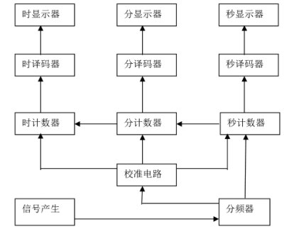

# 数字电子钟

数字钟把时基、计数、译码和显示连在一起。我用 CD4029 构成计数环节，再处理走时、校时和整点报时。原报告里既有整体框图，也保留了电路与波形，能沿着信号从一个模块读到下一个。

[计数与数码管电路](../assets/counter-circuit.jpg) · [原仿真波形](../assets/timing.jpg)

[返回专题](../) · [作品集首页](../../../)
