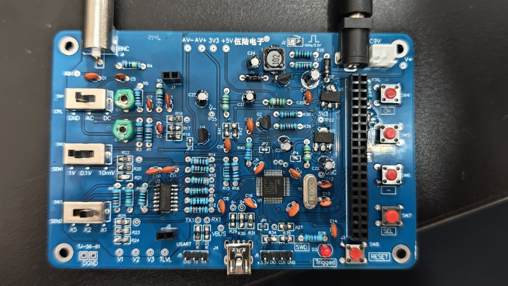
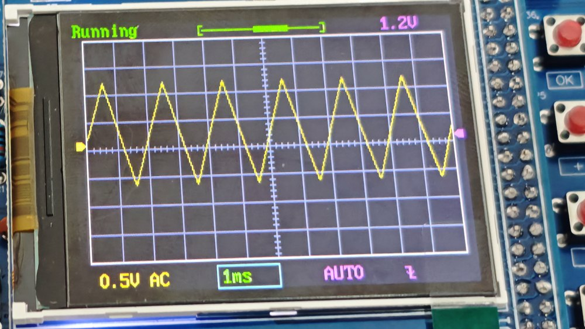

# 便携式数字示波器装调

我焊接并调试了便携数字示波器套件。输入信号先经过模拟前端调理，再由 ADC 采样，最后在 TFT 上显示。面板上的耦合方式、垂直刻度和时基决定了同一段波形如何呈现。

| 装调报告中的板卡 | 示波器上的三角波 |
| --- | --- |
|  |  |

[带面板和按键的实物原帧](../assets/scope.jpg) · [信号发生器装配](signal-generator-lab.md)

[返回专题](../) · [作品集首页](../../../)
