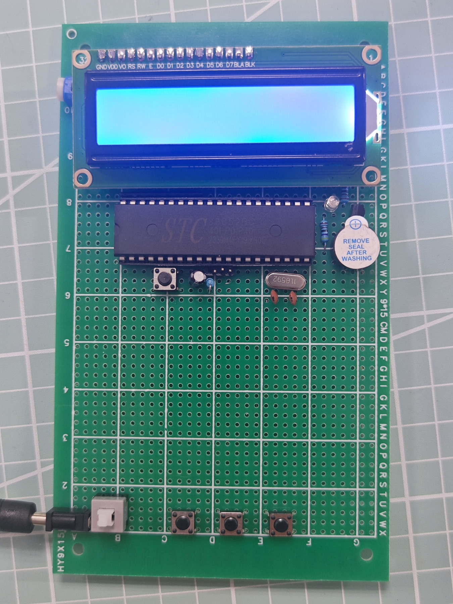
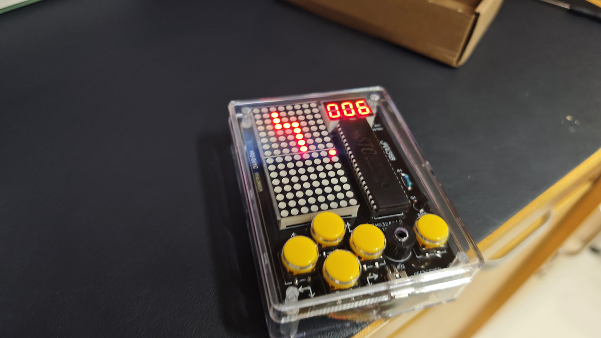
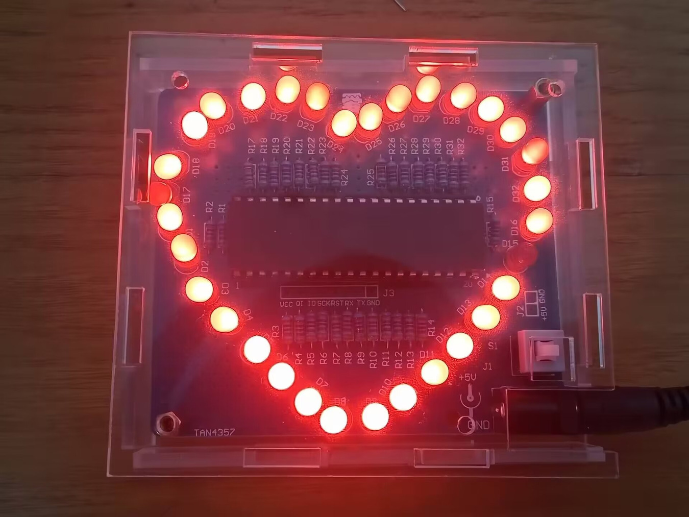
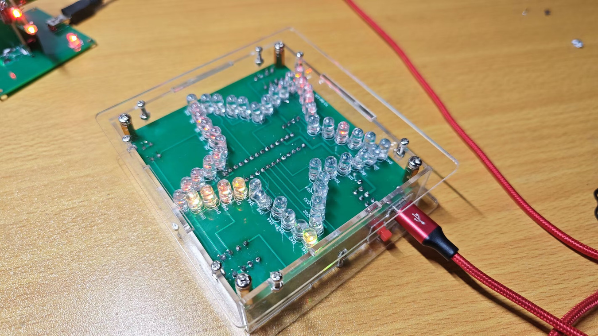
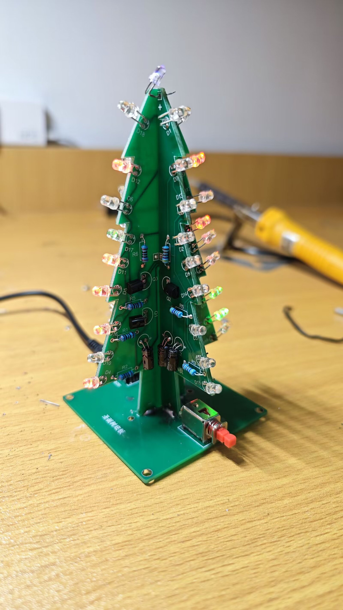
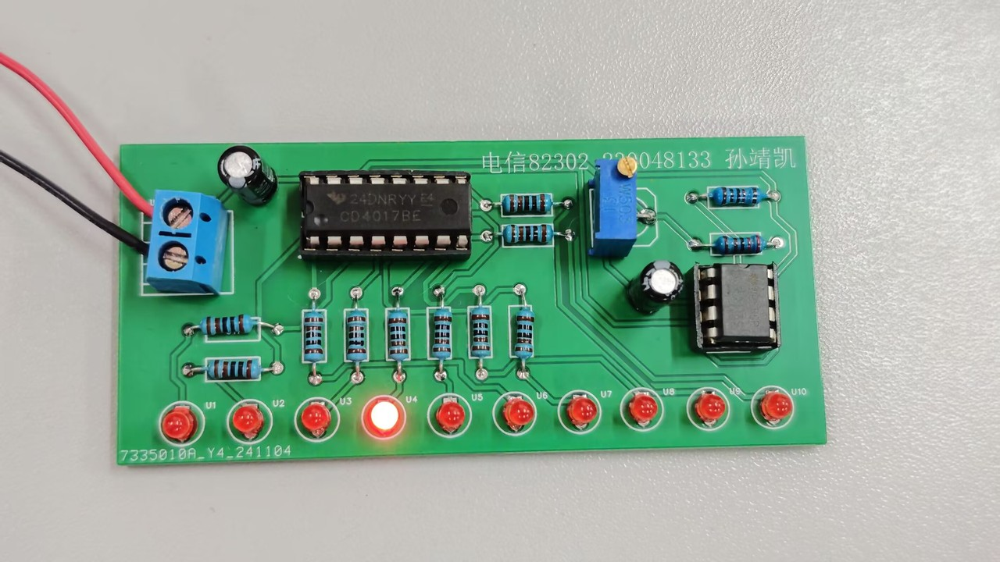

# 焊接套件与练习

我用这些套件练习辨认元件、焊接和上电检查。成品的反馈各不相同：最小系统板要看显示模块能否点亮，游戏机可以同时观察点阵画面和数码管，灯箱则可以直接看到 LED 的排列。

| 51 单片机最小系统板 | 点阵游戏机 |
| --- | --- |
|  |  |

| 心形灯箱通电 | 改进灯板的 LED 排布 |
| --- | --- |
|  |  |

| 立体圣诞树套件 | 流水灯板 |
| --- | --- |
|  |  |

[FM 无线传声器的元件面、焊点和波形](fm-transmitter-lab.md) · [返回电子实物专题](../)
