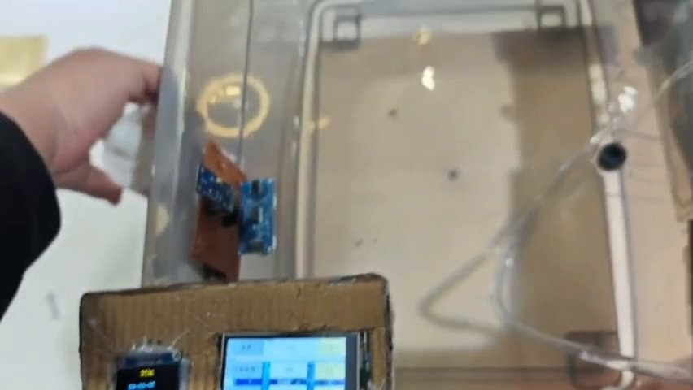
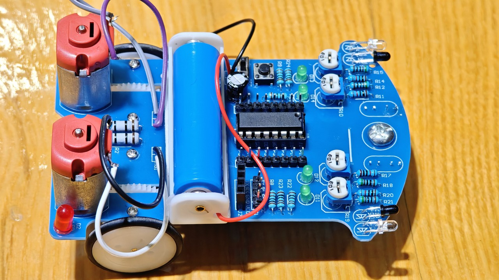
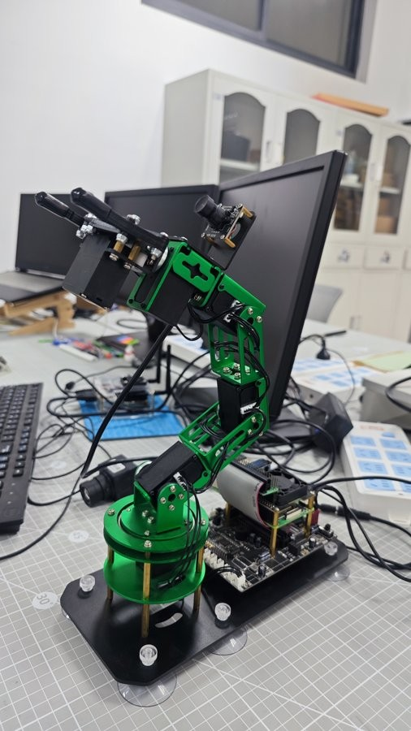

# 嵌入式与机器人

| 项目 | 控制平台 | 我负责的部分 |
| --- | --- | --- |
| [四足巡检机器人](../../projects/quadruped-robot/) | ESP32-C3、八路舵机 | 主控板、部分舵机程序、打印件适配和单机联调 |
| [无障碍饮水机](../../projects/accessible-water-dispenser/) | STM32F103、手势与语音模块 | 参与双模取水控制联调，负责结构绘图，独立设计换桶辅助装置 |
| [双向交通灯](../../projects/trafficlight-controller/) | Arduino Uno、OLED、数码管 | 独立开发控制固件，完成三种模式与双按键交互 |

## 桌宠的四个阶段

我先在 STM32 上调整舵机和结构，后来把桌宠做成 PowerPet 的 UPS 状态显示端，再转向 ESP32-C3 和 ESP32-S3。在演进页可以对照 C3 板卡正反面、触摸调试录像、机身参考模型和 S3 的 LCD 待命画面。[查看桌面机器人演进记录](../../projects/desktop-robot-evolution/)

## 团队及设备实践

[四足集群方向与单机原型](details/multi-robot-research.md) · [智能鱼缸](details/smart-aquarium.md) · [循迹小车](details/line-following-car.md) · [机械臂](details/robot-arm-lab.md)

| 智能鱼缸的触屏控制 | 循迹小车底板 | 机械臂实验设备 |
| --- | --- | --- |
|  |  |  |

鱼缸图片取自省级大创团队的演示视频，前景是控制面板，我承担项目文档撰写。小车和机械臂对应我的设备操作与调试实践。另有 51、STM32 和 ESP32 开发板的外设学习记录。[开发板实物](details/dev-board-labs.md) · [51 外设练习](details/mcs51-peripheral-labs.md) · [STM32 外设练习](details/stm32-peripheral-labs.md)
