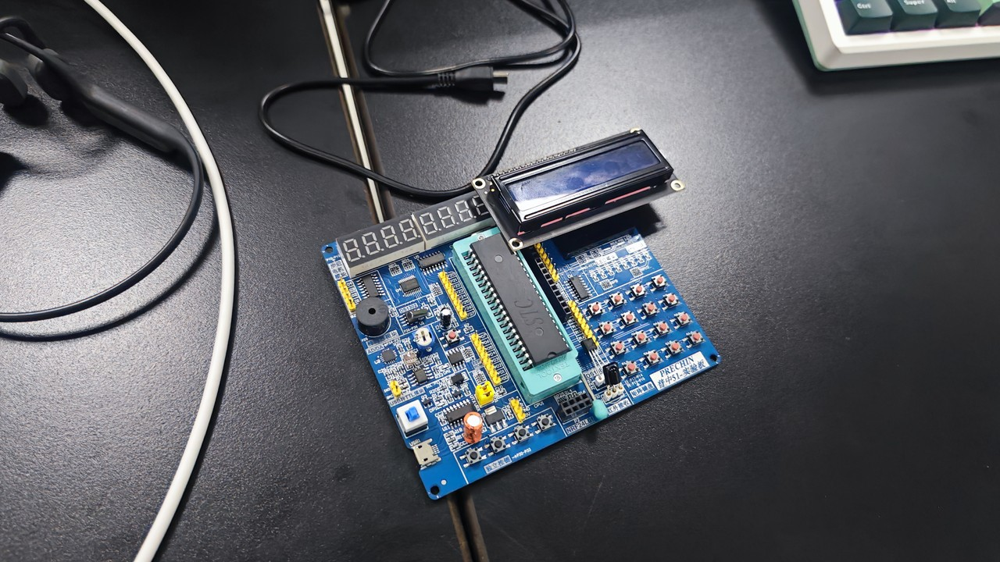

# 开发板综合练习

我在不同开发板上练习 GPIO、定时和外设通信，随后把舵机控制、屏幕和按键带进整机。图中是练习时使用的开发板。

[51 外设记录](mcs51-peripheral-labs.md) · [STM32 外设记录](stm32-peripheral-labs.md) · [Arduino 交通灯固件](../../../projects/trafficlight-controller/)

[返回专题](../) · [作品集首页](../../../)
