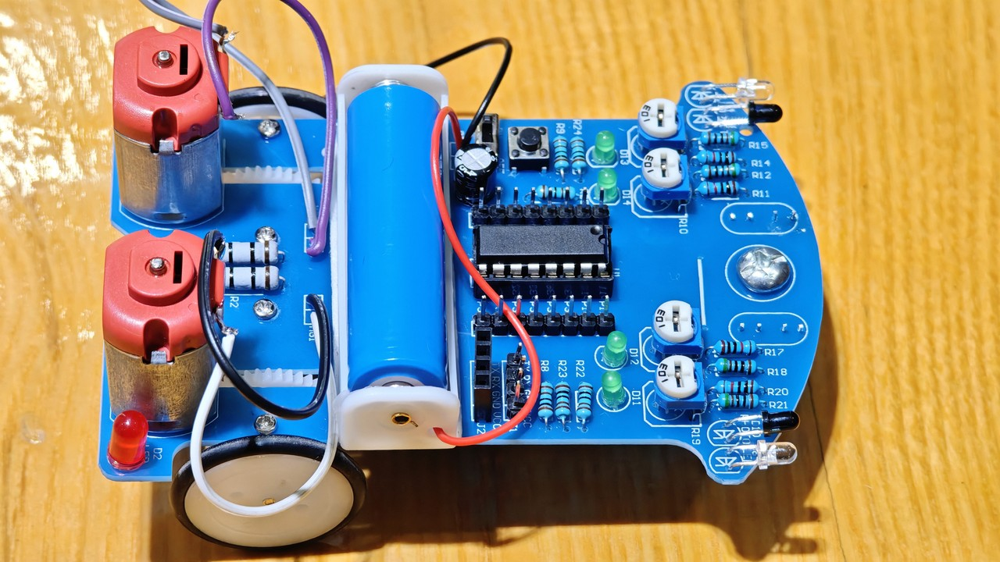
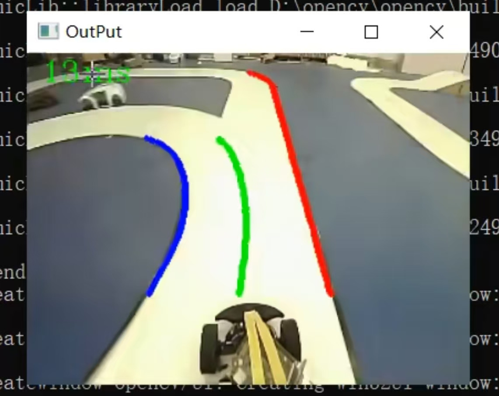

# 循迹小车

我参与了循迹小车的实物调试及图像识别实践。下图保留小车底板及板上布置，可与机械臂、四足机器人的装配方式对照。

这张调试截图显示弯道处的识别叠图。红、蓝线沿道路两侧延伸，绿色曲线位于赛道中间，可以对照原画面检查弯道处的定位。

[打开实物照片](../assets/car.jpg) · [四足机器人摄像头回传](../../../projects/quadruped-robot/)

[返回专题](../) · [作品集首页](../../../)
