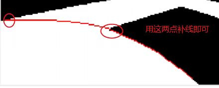

# 循迹小车的弯道识别与补线

我参与了小车的实物调试和赛道图像识别。调试时，我把边线和中线叠回摄像头画面，检查小车进入弯道时，识别出的路径是否仍落在赛道内。

## 在弯道上核对三条线

蓝线沿左侧弯道延伸，红线标出右侧边界，绿线是引导线。在这帧画面里，可以直接比较绿线的转向与实际弯道是否一致。[打开调试截图](../assets/track-view.jpg)

## 边界断开时怎样补线

这张标注图记录了八邻域扫线时遇到的一处边界缺口。红圈标出准备用来补线的两个位置，红线示意如何把这段边界接起来。[打开补线标注图](../assets/track-gap-annotation.jpg)

## 实物底板

[嵌入式与机器人](../) · [数字图像处理与摄像头识别](../../imaging/) · [作品集首页](../../../)
