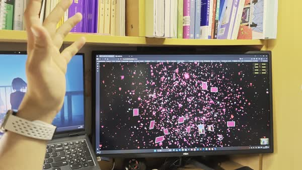
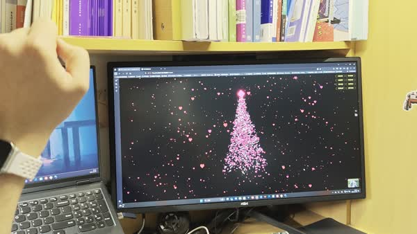
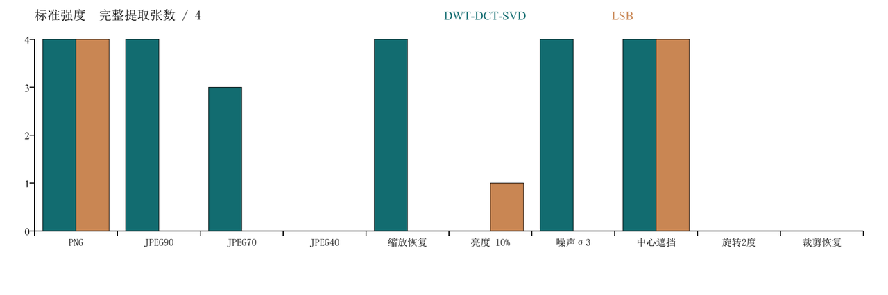

# 数字图像处理与摄像头识别

这组项目有两种输入：实时摄像头画面用于交互，已有照片用于增强、复原和特征提取。前者要看人做动作后屏幕怎样响应，后者可以固定同一张输入图，逐项比较算法带来的变化。

## 摄像头手势怎样控制屏幕上的粒子

| 张开手掌 | 收拢手指 |
| --- | --- |
|  |  |

这两张图取自我的现场录像。网页通过浏览器摄像头获取画面，使用 MediaPipe HandLandmarker 提取手部关键点，再把手势状态交给 Three.js。张掌时粒子散开，收拢手指时粒子重新聚成树形。显示器前的手和屏幕效果可以在同一画面里对照。

在网页程序里，我用腕点到掌部关键点的距离估计手掌尺度，将各指尖到腕点的距离与这个尺度比较。这样，手靠近镜头、画面变大时，判断阈值也会相应变化。手掌位置还参与控制散开场景的旋转，主题切换设有防抖间隔，避免一次持续手势反复触发切换。这里使用现成的关键点模型，个人实践集中在手势判定和交互映射。

## 摄像头回传与目标识别

[四足机器人](../../projects/quadruped-robot/)的摄像头负责采集和回传，画面由团队的 Qt 客户端接收。我也参与过循迹小车和机械臂的设备调试及图像识别实践。[设备照片](../embedded/)

在焊丝计数等离线识别项目中，输入换成单张照片，结果是可与人工标注核对的目标框。检测框重叠、漏掉端面或把一个对象框两次，都会影响最终数量。[检测框实图与评估](../ml/)

## 从照片生成拼豆图纸

我把照片按网格采样，再从固定色卡中为每个格子选色。最后导出带编号的图纸和各颜色的用量，透明格子留空。[算法源码与可运行示例](../../projects/bead-pattern-generator/)

## 增强与复原

| 实验 | 我比较了什么 |
| --- | --- |
| 暗光增强 | 同一张暗光图上，全局直方图均衡把平均亮度从 0.262 提到 0.508，CLAHE 提到 0.324。两种方法对亮度、色偏和高光截断的影响不同。[逐场景指标](data/contrast.csv) |
| 图像去雾 | 在开发集的 29 个真实雾案例中，V2 的平均 SSIM 从输入图的 0.487 提升到 0.652。表中还可按场景条件比较 CLAHE 和暗通道方法。[分组结果](data/dehazing.csv) |
| 模糊复原 | 180 个案例中，残差回归让平均 PSNR 从 23.79 dB 提升到 25.77 dB，SSIM 却从 0.751 降到 0.746。两种指标对复原效果给出了不同评价。[各方法对照](data/deblurring.csv) |
| 指纹特征 | 比较灰尘、遮挡、模糊对纹线端点与分叉点提取的影响，按干扰条件统计筛选前后的候选数量。[细节点统计](data/fingerprint.csv) |

## 实验画面

原实验把同一输入的不同增强结果和亮度分布放在一起。看图时，我先对照暗部轮廓有没有变清楚，再看亮部像素是否被挤到直方图边缘。这能解释为什么亮度提高最多的方法未必最合适。

模糊复原的合成样本有清晰参考图，可以把输入、锐化、维纳复原和学习方法并排比较。表中的平均值覆盖多张图；此图只展示一个样本的变化。

## 盲水印与照片卡通化

我比较了变换域 DWT-DCT-SVD 和像素最低有效位 LSB 两条水印路线。实验分开记录嵌入后图像的变化和处理后能否提取信息。下面是原工程保存的汇总图。

照片卡通化项目把保边滤波、边缘提取与颜色量化串起来。同一张照片可以改变颜色层次数，观察色块的简化程度和轮廓是否保留。原工程提供单张预览和批量输出。
