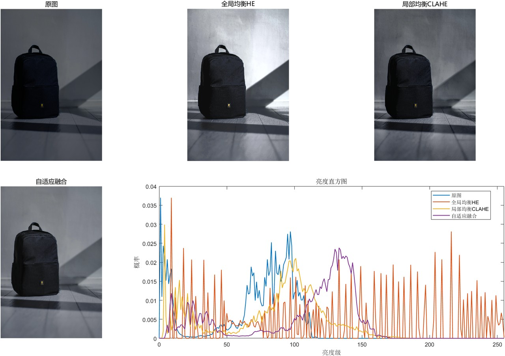
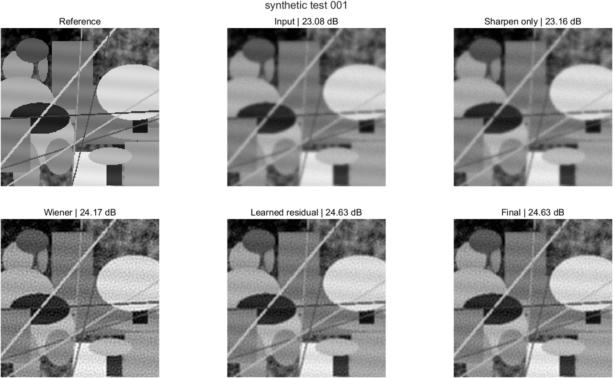

# 数字图像处理与摄像头识别

这组项目有两种输入：实时摄像头画面用于交互，已有照片用于增强、复原和特征提取。前者要看人做动作后屏幕怎样响应，后者可以固定同一张输入图，逐项比较算法带来的变化。

| 输入与用途 | 项目详情和原始材料 |
| --- | --- |
| 摄像头与设备 | [手势与粒子](../../projects/camera-hand-interaction/) · [四足机器人画面回传](../../projects/quadruped-robot/) · [循迹小车](../embedded/details/line-following-car.md) · [机械臂](../embedded/details/robot-arm-lab.md) |
| 照片里的目标与纹理 | [焊丝端面计数](../../projects/weld-wire-counter/) · [指纹细节点](../../projects/fingerprint-feature-extraction/) |
| 增强与复原 | [暗光增强](../../projects/image-contrast-lab/) · [场景去雾](../../projects/adaptive-dehazing/) · [模糊复原](../../projects/image-deblurring-lab/) |
| 图像转换与编码 | [拼豆图纸生成](../../projects/bead-pattern-generator/) · [照片卡通化](../../projects/image-cartoonization/) · [盲水印](../../projects/image-watermark-lab/) |

## 摄像头手势怎样控制屏幕上的粒子

| 张开手掌 | 收拢手指 |
| --- | --- |
|  |  |

这两张图取自我的现场录像。[观看连续动作和打开原网页程序](../../projects/camera-hand-interaction/)

网页通过浏览器摄像头获取画面，使用 MediaPipe HandLandmarker 提取手部关键点，再把手势状态交给 Three.js。张掌时粒子散开，收拢手指时粒子重新聚成树形。显示器前的手和屏幕效果可以在同一画面里对照。

在网页程序里，我用腕点到掌部关键点的距离估计手掌尺度，将各指尖到腕点的距离与这个尺度比较。这样，手靠近镜头、画面变大时，判断阈值也会相应变化。手掌位置还参与控制散开场景的旋转，主题切换设有防抖间隔，避免一次持续手势反复触发切换。这里使用现成的关键点模型，个人实践集中在手势判定和交互映射。

## 摄像头回传与目标识别

[四足机器人](../../projects/quadruped-robot/)的摄像头负责采集和回传，画面由团队的 Qt 客户端接收。我也参与过循迹小车和机械臂的设备调试及图像识别实践。[循迹小车实物](../embedded/details/line-following-car.md) · [机械臂实物](../embedded/details/robot-arm-lab.md)

在焊丝计数等离线识别项目中，输入换成单张照片，结果是可与人工标注核对的目标框。检测框重叠、漏掉端面或把一个对象框两次，都会影响最终数量。[焊丝检测程序与逐图评估](../../projects/weld-wire-counter/)

## 从照片生成拼豆图纸

我把照片按网格采样，再从固定色卡中为每个格子选色。最后导出带编号的图纸和各颜色的用量，透明格子留空。[算法源码与可运行示例](../../projects/bead-pattern-generator/)

## 增强与复原

| 实验 | 我比较了什么 |
| --- | --- |
| [暗光增强](../../projects/image-contrast-lab/) | 同一张暗光图上，全局直方图均衡把平均亮度从 0.262 提到 0.508，CLAHE 提到 0.324。两种方法对亮度、色偏和高光截断的影响不同。[逐场景指标](data/contrast.csv) |
| [场景感知自适应去雾](../../projects/adaptive-dehazing/) | 9 张雾图分别比较 Retinex、暗通道和自适应融合；另用同一张清晰图合成轻、中、浓雾，检查细节恢复程度。[三档雾的配对指标](../../projects/adaptive-dehazing/results/paired_metrics.csv) |
| [模糊复原](../../projects/image-deblurring-lab/) | 180 个案例中，残差回归让平均 PSNR 从 23.79 dB 提升到 25.77 dB，SSIM 却从 0.751 降到 0.746。两种指标对复原效果给出了不同评价。[各方法对照](data/deblurring.csv) |
| [指纹特征](../../projects/fingerprint-feature-extraction/) | 比较灰尘、遮挡、模糊对纹线端点与分叉点提取的影响，按干扰条件统计筛选前后的候选数量。[细节点统计](data/fingerprint.csv) |

## 实验画面

原实验把同一输入的不同增强结果和亮度分布放在一起。看图时，我先对照暗部轮廓有没有变清楚，再看亮部像素是否被挤到直方图边缘。这能解释为什么亮度提高最多的方法未必最合适。

模糊复原的合成样本有清晰参考图，可以把输入、锐化、维纳复原和学习方法并排比较。表中的平均值覆盖多张图；此图只展示一个样本的变化。

## 盲水印与照片卡通化

| 盲水印 · 压缩后的咖啡照片 | 照片卡通化 · 街景轮廓合成 |
| --- | --- |
|  |  |
| 照片里嵌入的文字能否在压缩后读回来？[原图、嵌入、压缩与提取结果](../../projects/image-watermark-lab/) | 哪些细节会变成线，哪些会合成色块？[电车分步图与长毛猫的两种画法](../../projects/image-cartoonization/) |
