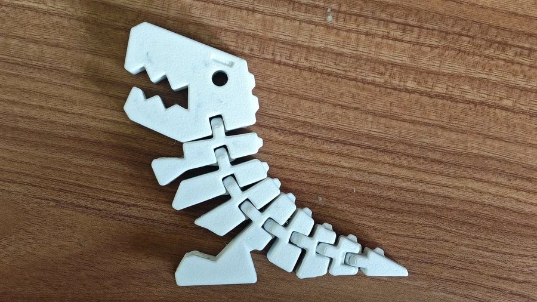

# 结构设计与制造

**机器人装配。** 四足原型的舵机要和打印腿件配合。我用 SolidWorks 修改结构件，再把主控板、舵机和线束装回机身。STM32 桌宠的装配也涉及打印公差和舵机适配。[查看四足机器人装配照片](../../projects/quadruped-robot/)

**饮水机换桶结构。** 我为桶装水更换辅助装置建模、出附图，并绘制饮水机论文中的结构图。这部分工作把使用者的换桶动作变成了具体的机械设计。[查看饮水机项目](../../projects/accessible-water-dispenser/)

**制图与加工。** 课程和制作实践还包括 CAD 平面制图、FDM 打印、激光切割、金工实习和创意灯具制作。下图是打印实践中的可动关节样件。

