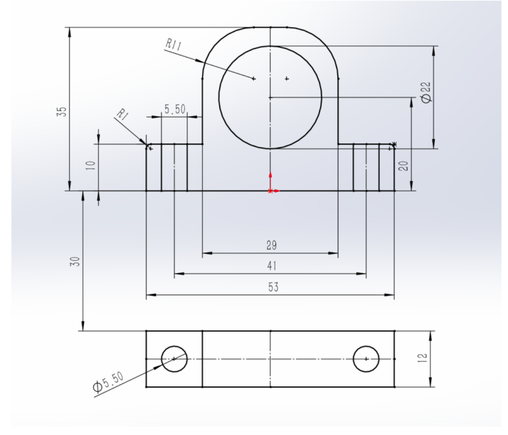
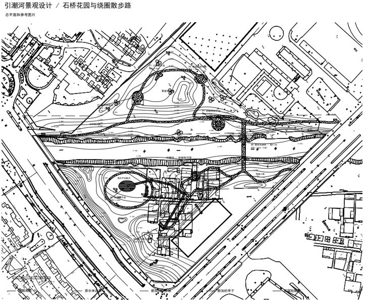

# CAD 制图与 SolidWorks 建模

## 可以打开的图纸与三维模型

| 作品 | 可下载文件 | 查看方式 |
| --- | --- | --- |
| 引潮河景观平面设计 | [石桥花园 DWG](drawings/stone-bridge.dwg) · [方亭庭院 DWG](drawings/pavilion.dwg) · [木桥林园 DWG](drawings/wood-bridge.dwg) | 三种布局分别保存。用 CAD 打开模型空间查看线形、铺装和分区；配套的[地形符号 SHX](drawings/topo_symbols.shx)可与图纸放在同一文件夹 |
| 饮水机换桶辅助装置 | [机构附图 DWG](drawings/bottle-tray.dwg) | 查看柜体、托板与驱动组件的投影及标注。[设计说明](../../projects/accessible-water-dispenser/) |
| 带孔支座 | [旋转查看 STL](drawings/bracket.stl) · [三维实体 DWG](drawings/bracket.dwg) | 按 SolidWorks 作品集第 2 页的尺寸草图复建，单位为毫米 |

前四份 DWG 从完成版图纸的模型空间导出，用于单独查看几何与标注。下面是支座的原草图和此次复建的实体。外形宽 68、高 60、厚 12 毫米；中间通孔直径 28 毫米，两个安装孔直径 6.5 毫米、中心距 54 毫米。STL 可用于旋转预览，DWG 保留三维实体。

| 作品集中的尺寸草图 | 按图复建的支座 |
| --- | --- |
|  |  |

## SolidWorks：从尺寸草图到三维外形

我用 SolidWorks 练习尺寸约束和零件建模。左图取自建模作品集，孔径、孔距、台阶和圆角分别标注；右图是另一件作品，展示手机支架的背板、底座和前端承托形状。

| 带尺寸的零件草图 | 手机支架模型 |
| --- | --- |
|  |  |

在[四足机器人](../../projects/quadruped-robot/)项目里，我在已有模型上修改安装件，处理舵机和腿部结构的配合。在[饮水机换桶装置](../../projects/accessible-water-dispenser/)项目里，我从托板的运动方式入手设计升降机构，并独立绘制了申请附图。

## CAD：引潮河沿岸的三套平面方案

同一处滨水空间，我分别整理了石桥花园、方亭庭院、木桥林园三套方案。每套工程都保留 DWG 图纸及 PDF 出图。以下是石桥花园的总平面节选，能看到沿岸步道、桥位及周边建筑之间的关系。

## 加工与制作

| FDM 打印的关节样件 | 激光切割设备工作现场 |
| --- | --- |
|  |  |

打印样件保留了分节连接的结构。另两项实物记录分别来自金工实习和创意灯具制作。

| 金工实习中留下的小件 | 点亮后的莲花图案灯具 |
| --- | --- |
|  |  |
