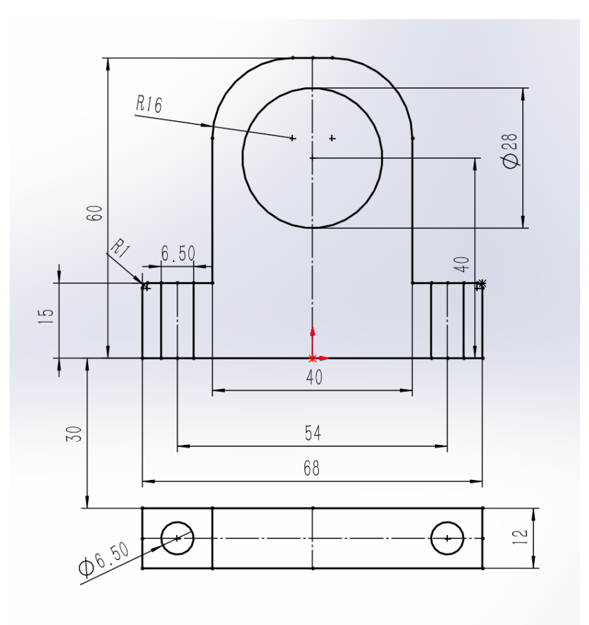
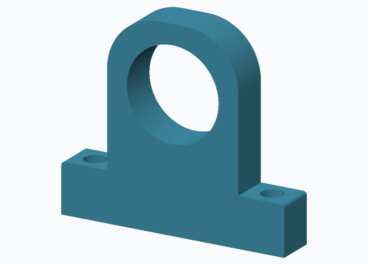

# 带孔支座：从尺寸草图到三维实体

原 SolidWorks 作品集留下了尺寸草图。我按图复建了可旋转的支座，外形宽 68、高 60、厚 12 毫米。中间通孔直径 28 毫米，两安装孔直径 6.5 毫米，中心距 54 毫米。

| 原尺寸草图 | 复建实体 |
| --- | --- |
|  |  |

[旋转查看 STL](../drawings/bracket.stl) · [下载三维实体 DWG](../drawings/bracket.dwg)

[返回专题](../) · [作品集首页](../../../)
