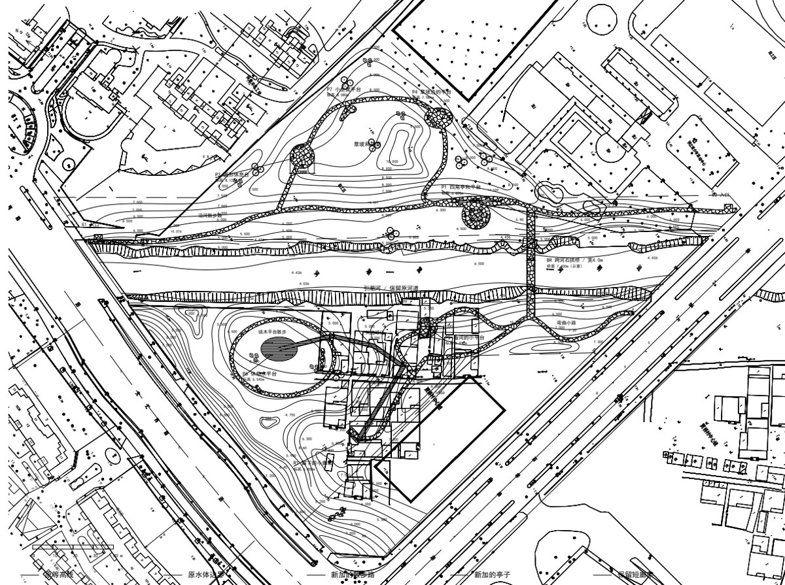
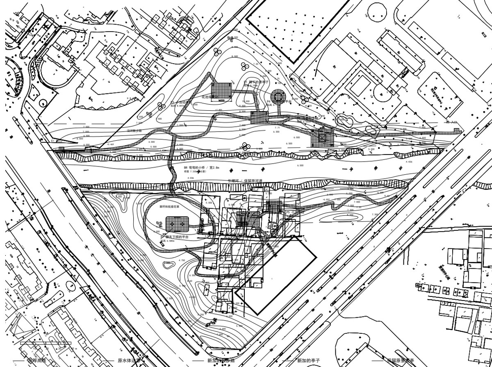
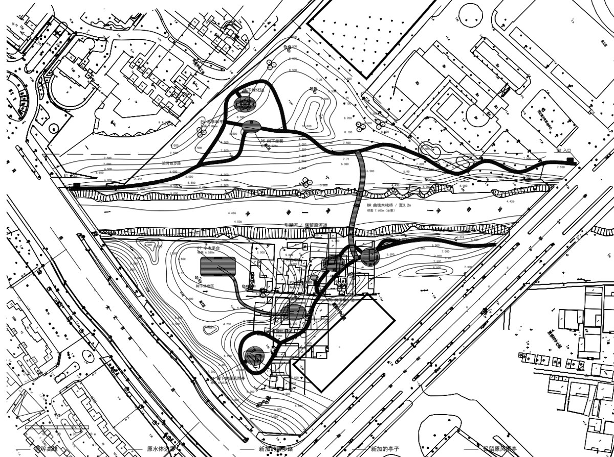

# CAD 制图与建模

同一段引潮河滨水空间，我分别做了顺地形慢行、折线庭院和林缘环路三套布局。三份原工程各自出图，下面以相同视角抽取总平面，方便比较桥位与路径怎样变化。

| 方案 | 总平面节选 | CAD 图纸 |
| --- | --- | --- |
| 石桥花园 |  | [模型空间 DWG](../drawings/stone-bridge.dwg) |
| 方亭庭院 |  | [模型空间 DWG](../drawings/pavilion.dwg) |
| 木桥林园 |  | [模型空间 DWG](../drawings/wood-bridge.dwg) |

[地形符号字体](../drawings/topo_symbols.shx)可与 DWG 放在一起。

[返回专题](../) · [作品集首页](../../../)
