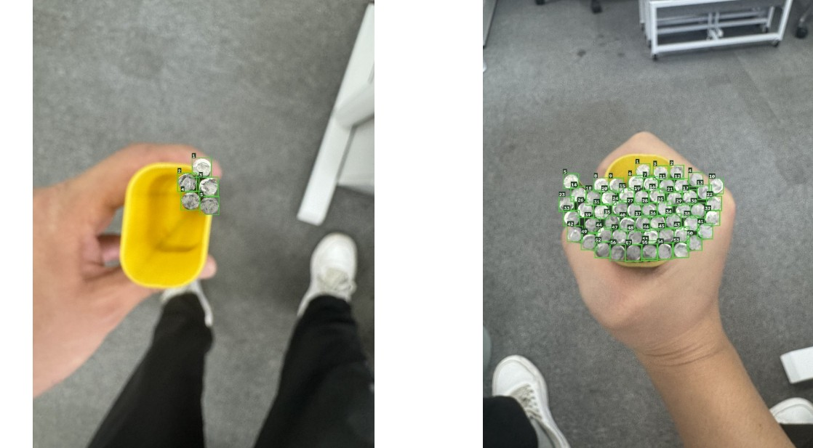
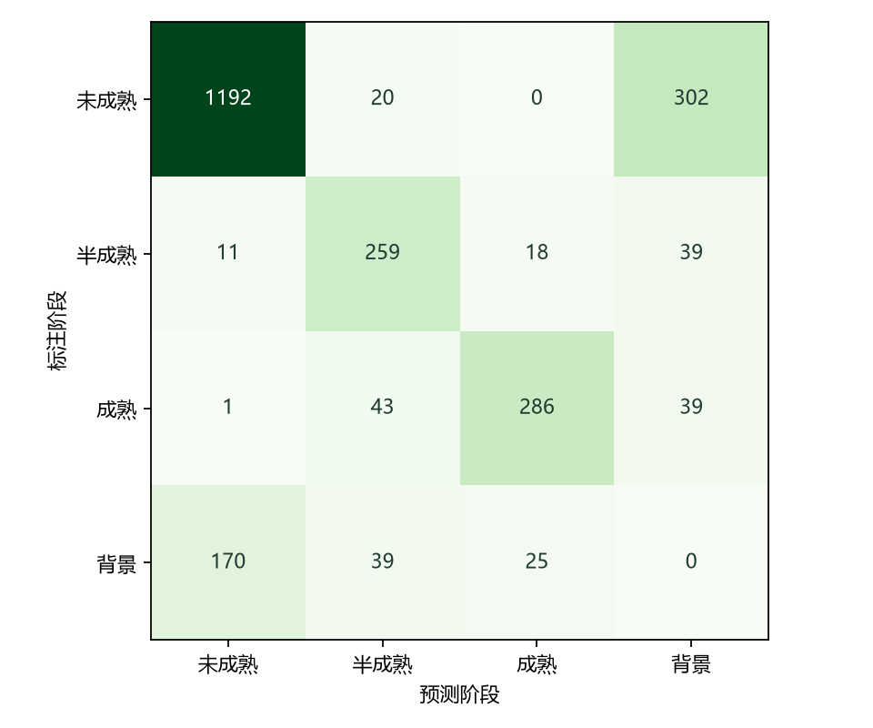
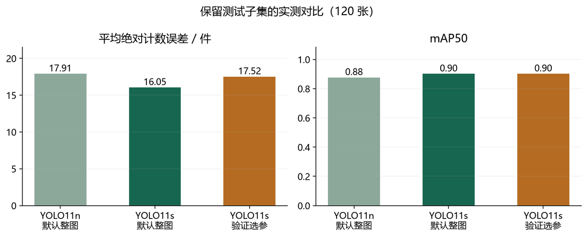
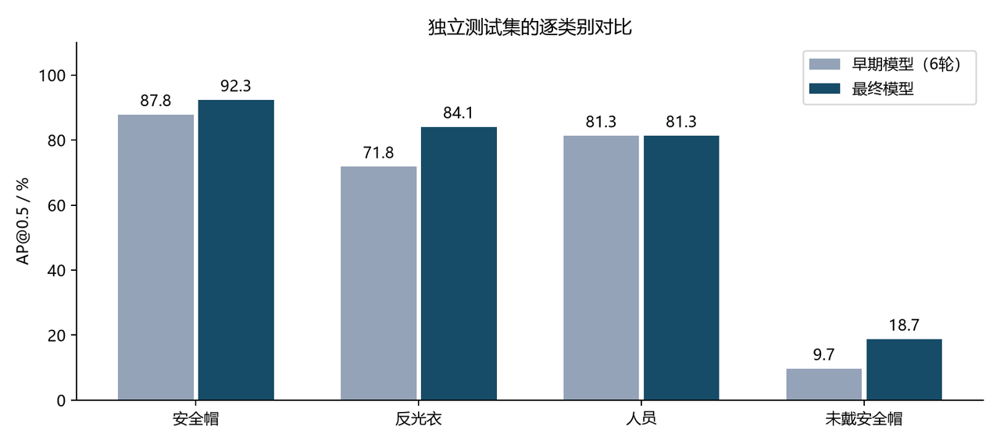
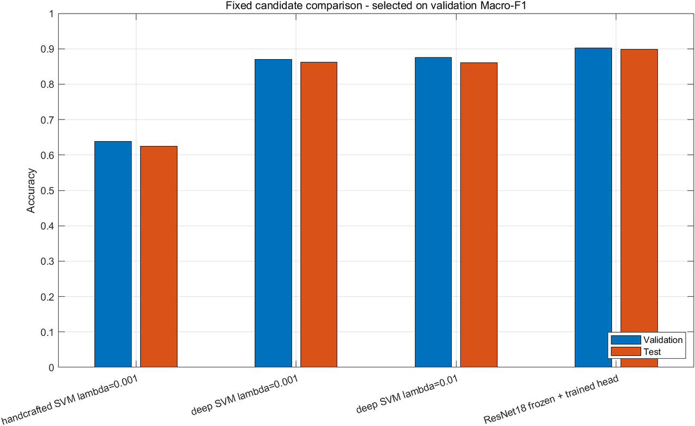
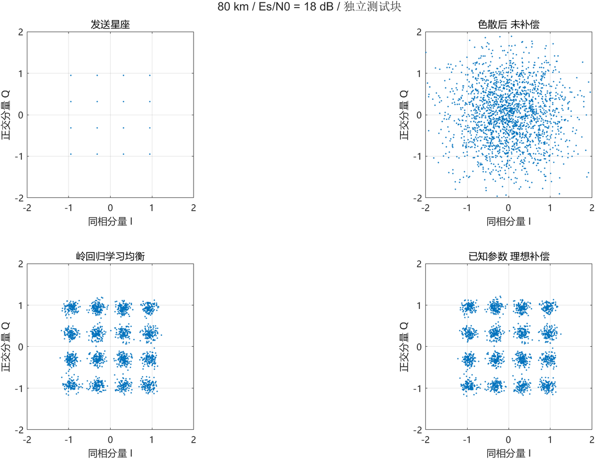

# 机器学习项目：从道路裂缝检测开始

这九个项目里，我最想先介绍[道路裂缝检测与形态分类](../../projects/road-crack-detection/)：同一张路面照片，先判断哪些图块值得检查，再找出裂缝像素，最后判断区域形态。我把 118 对图像与标注先按原图划分，再裁成图块；如果先裁后分，相邻路面的纹理容易同时出现在训练和测试中。

内部测试集上，TinyCNN 的图块筛查 F1 为 0.837，高于 HOG + SVM 的 0.657；换到外部样本后，两者分别为 0.761 和 0.790。这个结果也影响了我看其他实验的方式：除了报告模型得分，还要交代测试单位、比较基线，以及换一批数据后结论是否仍然成立。

## 九个项目分别解决什么问题

| 项目 | 使用的方法 | 我怎样判断结果 |
| --- | --- | --- |
| [道路裂缝](../../projects/road-crack-detection/) | MATLAB、TinyCNN、HOG + SVM、多通道像素特征与随机森林 | 分别看图块 F1、逐图 IoU、区域分类和整图召回 |
| [焊丝端面计数](../../projects/weld-wire-counter/) | YOLOv8n 迁移学习、ONNX FP32、CPU 推理 | 比对人工计数，再检查导出前后的逐图输出 |
| [番茄成熟阶段](../../projects/tomato-ripeness-counting/) | YOLOv8n、基线与微调模型 | 同时核对类别混淆和每图计数误差 |
| [货架盘点](../../projects/shelf-inventory-counting/) | YOLO11n/s、整图与切块推理 | 固定阈值和测试图，比较漏检、重复检测与件数误差 |
| [施工安全穿戴](../../projects/construction-ppe-detection/) | YOLO 检测、早期与最终模型对照、ONNX | 分开报告安全帽、反光衣、人员、未戴安全帽的 AP50 |
| [花卉识别与检索](../../projects/flower-recognition-retrieval/) | MATLAB、手工特征、深度特征、SVM、ResNet-18 | 用验证集选模，在测试集核对分类准确率与宏平均 F1 |
| [指纹预处理与特征提取](../../projects/fingerprint-feature-extraction/) | 纹线增强、端点与分叉点、64 维特征与袋装回归树 | 按干扰种类检查细节点；质量评分分支用带主观质量分的数据训练 |
| [图像锐化与模糊复原](../../projects/image-deblurring-lab/) | 维纳复原、残差岭回归 | 将复原图与清晰参考图对照，分别看 PSNR 和 SSIM |
| [光纤色散补偿](../../projects/optical-dispersion-compensation/) | 16QAM、岭回归均衡、信道条件迁移 | 比较错误比特数、BER 和补偿前后的星座图 |

图像复原和指纹在这里按学习方法归类，预处理步骤和结果表放在[图像处理与摄像头识别专题](../imaging/)。

## 分类的模型选择

花卉识别与检索项目中，我用 MATLAB 比较手工特征与深度特征。手工特征加 SVM 的测试准确率为 62.5%，冻结 ResNet-18 并训练分类头后为 89.8%。这组数字衡量的是分类环节。[模型对照](data/flowers.csv)

## 检测与计数

| 场景 | 实验和结果 |
| --- | --- |
| [番茄成熟度](../../projects/tomato-ripeness-counting/) | 把检测框分为未成熟、半成熟和成熟三类。145 张图上，微调前后每张图的平均绝对计数误差从 3.77 个降到 2.48 个。[计数对照](data/tomatoes.csv) |
| [货架盘点](../../projects/shelf-inventory-counting/) | 在同样的 120 张图上比较整图与切块推理。置信阈值取 0.25 时，切块让平均绝对误差从 16.05 件增加到 20.18 件。[不同阈值下的结果](data/shelves.csv) |
| [施工安全穿戴](../../projects/construction-ppe-detection/) | 记录 20 轮检测训练的精确率、召回率与 mAP，原工程保留了早期和最终版本的 ONNX 模型。[训练曲线数据](data/ppe.csv) |
| [焊丝端面](../../projects/weld-wire-counter/) | 使用 YOLOv8n 定位每个端面，汇总框数作为焊丝数量，并导出 ONNX。 |

### 焊丝端面：为什么还要人工数一遍

检测程序先框出每一个焊丝端面，再汇总框数。原验收记录中，48 张评估图有 46 张的预测总数与参考数一致，平均绝对误差为每图 0.0417 根。图中的密集案例人工参考数为 56，模型输出 57。把框的位置一起展示，才能检查多出的一根来自哪里。模型导出为 ONNX FP32 后，用相同预处理和阈值核对，同一批 48 张图的推理计数与导出前一致。

### 三类检测任务的结果各怎样读

| 番茄成熟阶段的混淆矩阵 | 货架商品检测与计数 |
| --- | --- |
|  |  |

番茄图的行是标注阶段，列是预测阶段。“背景”一行和一列保留了多检与漏检的信息。货架图把每图件数误差和 mAP 放在一起，可以看出框的位置质量接近时，数量误差仍可能不同。

| 施工穿戴检测：逐类 AP50 | 花卉分类：验证与测试准确率 |
| --- | --- |
|  |  |

穿戴检测中，最终模型在“安全帽”类上的 AP50 为 92.3%，在“未戴安全帽”类上只有 18.7%，所以需要分别报告。花卉实验比较了手工特征、深度特征加 SVM，以及冻结 ResNet-18 后训练分类头的结果。

## 光纤通信中的色散补偿

在 16QAM 仿真里，我用岭回归做均衡。在 80 km、12 dB 条件下，误码率从 0.4528 降到 0.0284。将同一模型换到 40 km、18 dB 条件下，误码率上升到 0.4622，说明补偿效果依赖信道条件。[固定信道实验](data/dispersion.csv) · [改变信道后的对照](data/channel-shift.csv)

星座图里的每个点对应一个接收符号。观察点云在 16 个理想位置附近的聚集程度，再结合实际错误比特数，可以同时检查补偿效果和判决错误。
