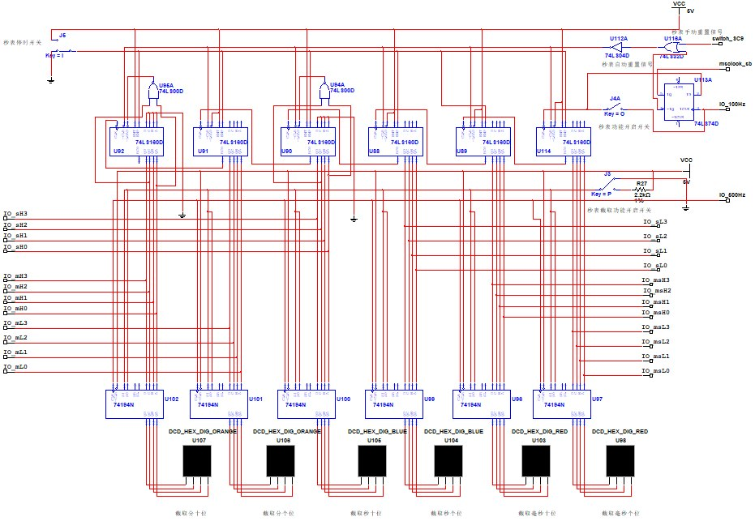
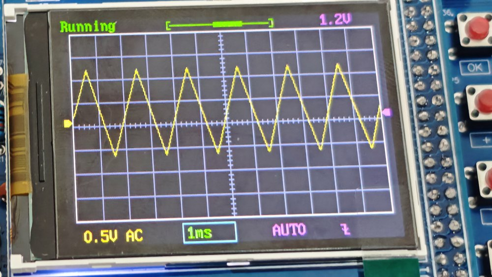

# 从传感器输入到波形测量

单片机里的数值从哪里来，怎样变成动作，又怎样在板上检查？下面的记录分别来自外设练习、装调报告和实物照片，可以顺着一次信号的去向看。

| 环节 | 我用什么来观察 | 项目与材料 |
| --- | --- | --- |
| 读入温度或脉冲 | DS18B20 温度读取与报警练习把同一读数用于显示和判断；STM32 输入捕获把边沿间隔转换为周期。 | [51 外设工程目录](../embedded/details/mcs51-peripheral-labs.md) · [STM32 定时器与外设](../embedded/details/stm32-peripheral-labs.md) |
| 输出动作 | 舵机需要控制脉冲，装入机身后还要检查回中位置、转向与连杆行程。交通灯的输出则由工作模式和计时状态决定。 | [桌宠的四次迭代](../../projects/desktop-robot-evolution/) · [四足机器人标定](../../projects/quadruped-robot/) · [双向交通灯固件](../../projects/trafficlight-controller/) |
| 产生和处理信号 | 模拟信号发生器留下了焊接板；数字钟报告把脉冲、计数和显示放在同一张电路图里。 | [模拟信号发生器](../electronics/details/signal-generator-lab.md) · [数字钟电路与仿真波形](../electronics/details/digital-clock-lab.md) |
| 观察输入 | 便携示波器套件把模拟前端、ADC 和 TFT 接起来。装调照片中能同时看到板卡与波形。 | [示波器板卡和三角波实拍](../electronics/details/digital-oscilloscope-kit.md) |

| 数字钟的计数与显示电路 | 示波器装调时的输入波形 |
| --- | --- |
|  |  |

左图来自数字钟仿真，右图来自示波器实物，分别记录两次实验。

## 十一个传感器设计

对同一个开关动作，温度、电容、光照和距离有不同的测量误差。我在这些方案里画出信号路径，选取器件，再计算量程、阈值或响应时间。每个条目都保留了原文的电路图、计算条件和参考资料。这里展示的是设计分析。

| 设计详情 | 测量和输出 | 原始文档 |
| --- | --- | --- |
| [NTC 温控风扇](details/ntc-fan.md) | 温度 → ADC → 风扇 | [正文与原图](designs/ntc-fan.pdf) |
| [水族箱水温监测](details/aquarium.md) | 单总线 → 温度提示 | [正文与原图](designs/aquarium.pdf) |
| [仓储温湿度监测](details/warehouse.md) | 数字温湿度 → 越限提示 | [正文与原图](designs/warehouse.pdf) |
| [庭院灯光照控制](details/garden-light.md) | 照度 → 延时开关 | [正文与原图](designs/garden-light.pdf) |
| [储水箱液位检测](details/tank-level.md) | 电容变化 → 液位估计 | [正文与原图](designs/tank-level.pdf) |
| [电容触摸台灯](details/touch-switch.md) | 电容变化 → 触摸开关 | [正文与原图](designs/touch-switch.pdf) |
| [反射式光电转速检测](details/tachometer.md) | 反射脉冲 → 转速 | [正文与原图](designs/tachometer.pdf) |
| [箱体倾斜检测](details/tilt.md) | 三轴加速度 → 倾角 | [正文与原图](designs/tilt.pdf) |
| [应变式电子秤](details/scale.md) | 桥式传感器 → 去皮与称量 | [正文与原图](designs/scale.pdf) |
| [超声感应开盖](details/ultrasonic-lid.md) | 回波脉宽 → 舵机动作 | [正文与原图](designs/ultrasonic-lid.pdf) |
| [桌面距离提示](details/tof-distance.md) | 飞行时间测距 → 接近提示 | [正文与原图](designs/tof-distance.pdf) |

[电子电路与测试](../electronics/) · [作品集首页](../../)
