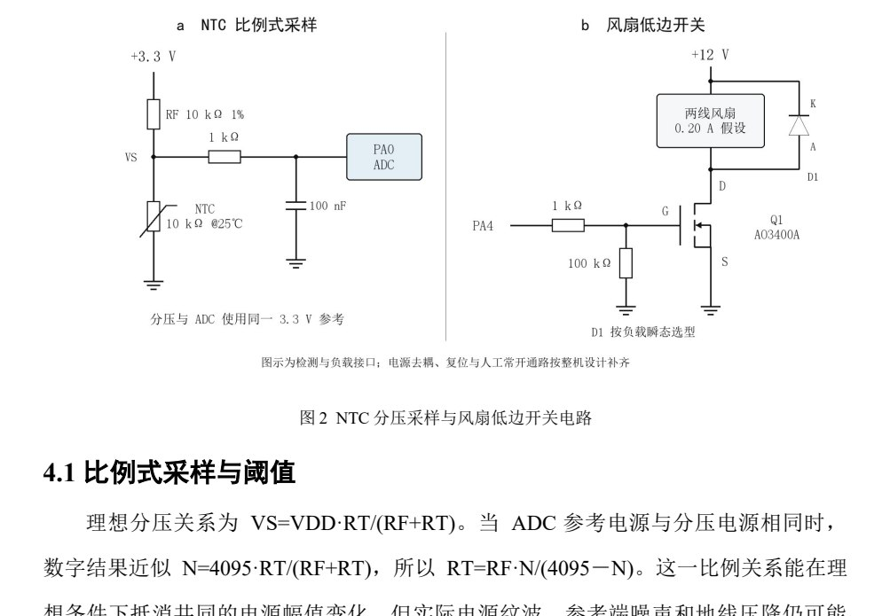

# NTC 温控风扇

[传感器专题论文合集](../#传感器专题论文合集) · 教师命题，孙靖凯检索资料、撰写并分析设计方案。

NTC 与固定电阻组成分压器，STM32F030 读取电压，再用 MOSFET 控制风扇。设计计算把热敏电阻的非线性、采样灵敏度和开关阈值放在一起看。加入回差，是为了避免读数在阈值附近波动时频繁启停。

[阅读论文正文、原理图与计算（PDF）](../designs/ntc-fan.pdf) · [返回传感与测量专题](../)
