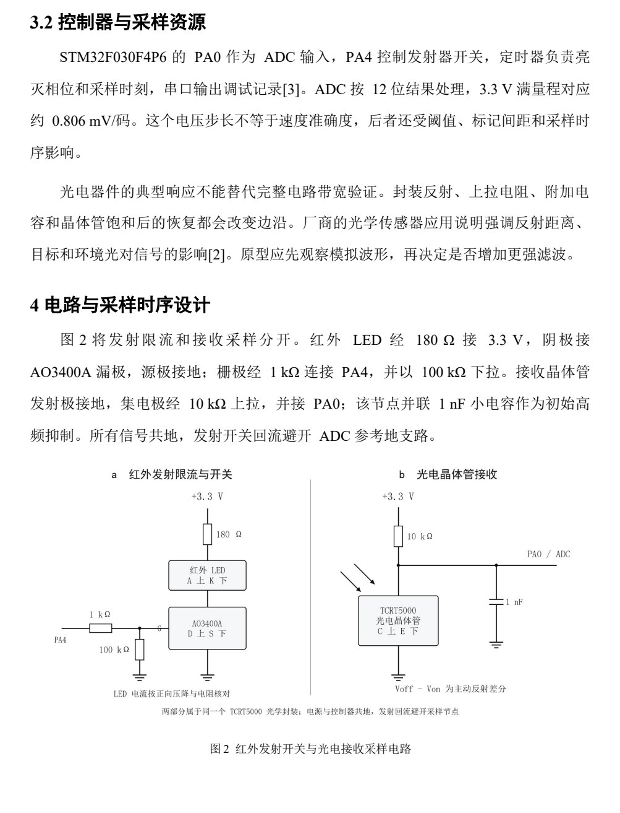

# 反射式光电转速检测

[传感器专题论文合集](../#传感器专题论文合集) · 教师命题，孙靖凯检索资料、撰写并分析设计方案。

TCRT5000 读取十二周期黑白码盘。转得慢时，固定时间窗内只有少量脉冲，增减一个就会明显改变结果。正文比较了窗口计数与周期测量，也讨论了环境光和安装距离。

[阅读论文正文、原理图与计算（PDF）](../designs/tachometer.pdf) · [返回传感与测量专题](../)
