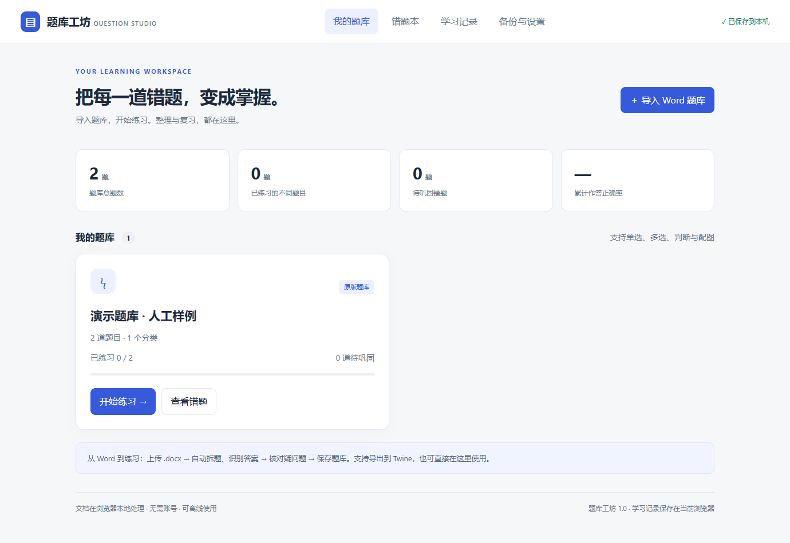

# 软件工具

## [离线题库工坊](../../projects/quiz-bank-workshop/)

我写这个工具是为了处理格式不统一的 Word 题库。导入时先拆分题干和选项，再把文末答案对应到题号；重复题、答案冲突或缺答案的题目会留给使用者核对。确认后即可在本地浏览器练习、看解析和复习错题。

项目附有解析引擎、构建脚本和自动化测试，可以自己生成离线 HTML。[查看源码、运行方法和答题界面](../../projects/quiz-bank-workshop/)

## [毕业生就业信息管理系统](../../projects/graduate-information-system/)

这个项目围绕就业登记表实现网页操作。单条记录可以在页面录入、修改和筛选，已有表格可以批量导入，再导出 Excel 或 PDF。原工程保留 HTML 页面、交付说明和测试表格；这里展示功能范围，公开演示从空表开始。[运行单页程序](../../projects/graduate-information-system/src/index.html)

## [桌面绘图与网页互动](details/python-utilities.md)

从像素画、线条绘图到浏览器粒子动画，每个作品都保留了自己的运行画面。[四叶草](details/clover-drawing.md) · [祝福便签](details/notes-web.md) · [手势粒子树](details/gesture-tree.md)
