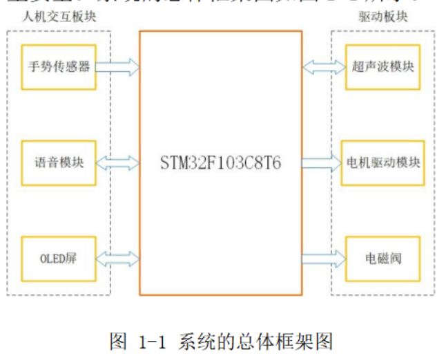
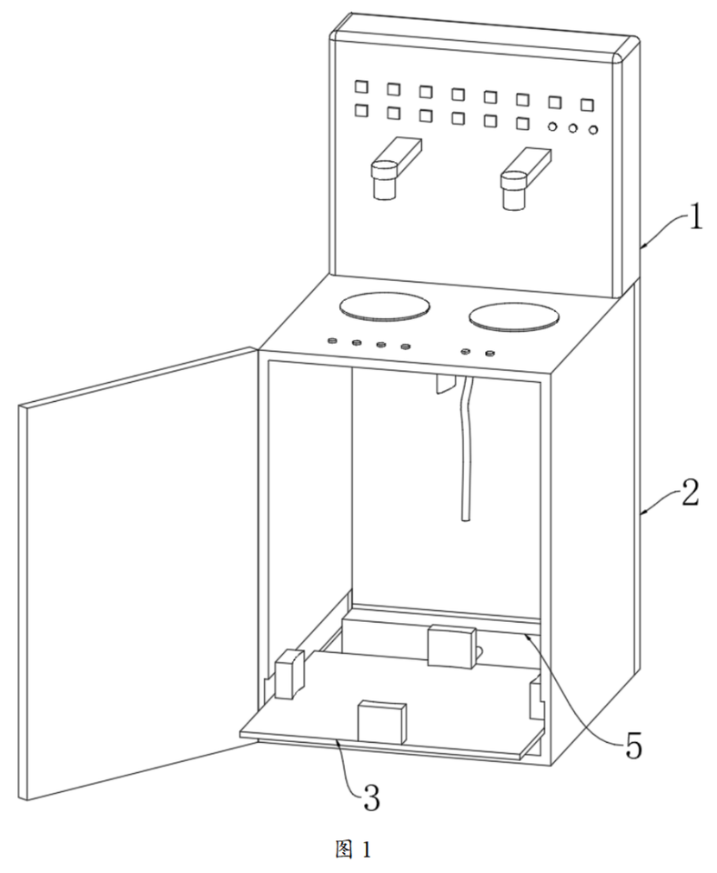

# 无碍智饮 · 手势与语音控制饮水机

**2025.09–2026.05｜院级大学生创新项目**

操作饮水机和更换重水桶，是两种不同的困难。团队用手势和语音控制日常取水，我参与双模取水控制联调，负责结构绘图，并独立设计了桶装水更换辅助装置。

## 日常取水：指令、杯位与出水

项目选用 STM32F103C8T6 作为主控。手势模块通过 I²C 接入，语音模块通过串口接入，使用者可以选择水温并确认取水。控制方案还包括杯位检测、步进电机升降杯台、出水控制和声音反馈。我参与了手势与语音指令的协调以及超时保护。下图是项目说明中绘制的控制架构。

## 更换水桶：托板怎样抬升

我用 SolidWorks 为换桶机构建模、绘制附图，并撰写实用新型申请材料。装置把水桶放在饮水机下部柜体里。按设计，电机和螺杆带动升降块水平移动，斜面将水平行程转成托板的上升行程，桶口随之靠近上方插管。图中 **3** 是承载水桶的托板，**5** 是柜内的驱动组件。

[换桶机构的 CAD 附图](../../collections/mechanical/drawings/bottle-tray.dwg) · [三套滨水总平面和支座模型](../../collections/mechanical/)

## 论文与专利申请文件

会议论文发表于 Springer 的 *Proceedings of the 2nd Electrical Artificial Intelligence Conference, Volume 3*（2026）。我列第四作者，绘制结构图并参与部分章节写作。[出版页面与作者顺序](https://doi.org/10.1007/978-981-95-7928-0_12)

换桶辅助装置由我独立申请实用新型，申请号 **202620256909.1**，受理日期为 **2026 年 3 月 3 日**。阅读图纸时可以先找托板（3）、升降块（4）和驱动组件（5），再对照权利要求 1 看三者如何配合。[申请摘要、权利要求与说明书](documents/application-text.pdf) · [摘要附图与结构详图](documents/application-figures.pdf) · [受理通知书节选](assets/application-receipt-excerpt.png)
