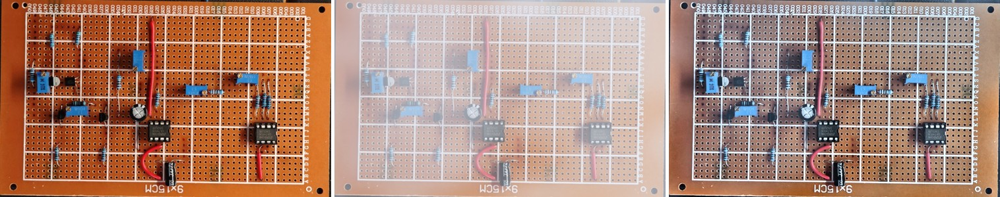

# 按场景调节强度的图像去雾

近景纹理、天空和远处有雾的区域，对增强强度的要求不同。我把暗通道、局部对比度与区域修正放到同一批图上比较，另外统计裁剪到亮度边界的像素比例，检查对比度增强是否损失了细节。

29 个真实雾开发案例中，输入图的平均 SSIM 为 0.487，CLAHE 为 0.628，V2 为 0.652。这组数字用于开发阶段的比较；逐案例原表同时保留场景编号、划分、方法和耗时。

这组图用随仓库发布的工程实拍生成，依次为清晰参考、模拟雾和 V2 输出。它单独说明处理流程，前文的开发集均值来自原实验。[演示脚本](demo.m)

[开发集逐案例记录](results/development.csv) · [按条件汇总](results/summary.csv) · [V2 的保护与修正逻辑](src/dehaze_v2.m)

在 MATLAB 的项目目录运行 `addpath('src'); r = dehaze_v2(imread('haze.jpg')); imshow(r.final)`，可以用自己的照片测试。对照方法和成对图指标也在[原程序目录](src/)。

[图像处理与摄像头识别](../../collections/imaging/) · [作品集首页](../../)
