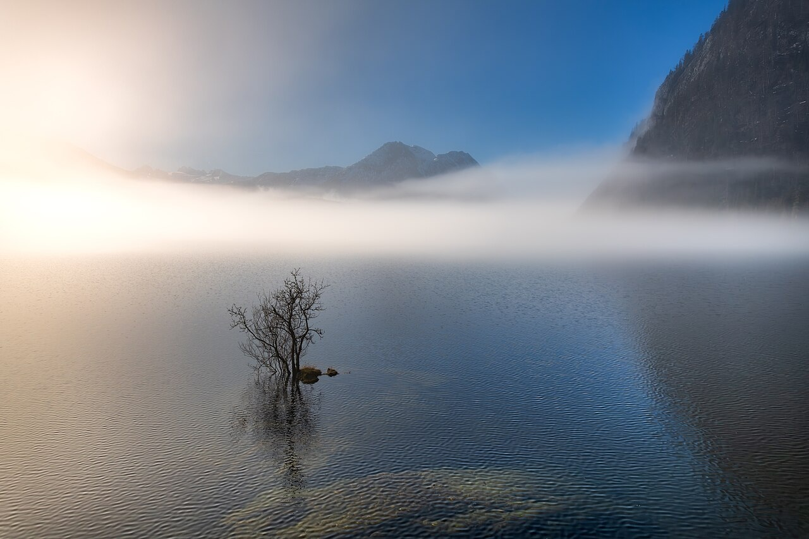
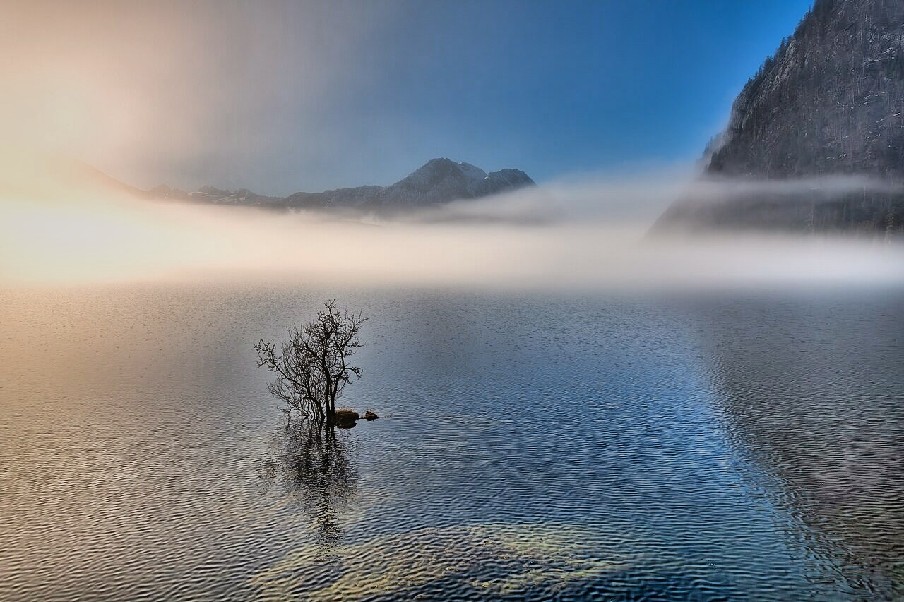
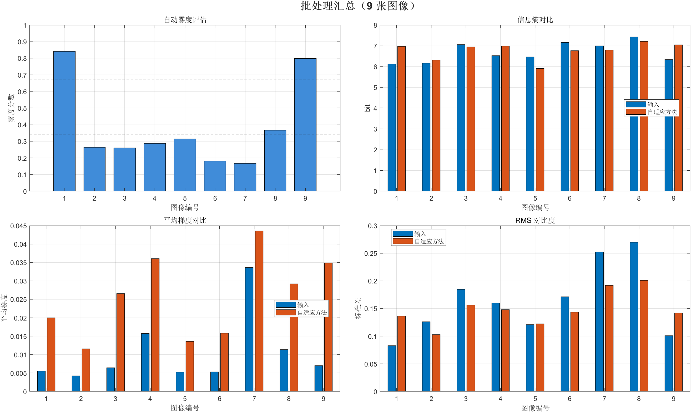

# 场景感知自适应去雾

雾中的树和远处的天空需要不同的处理强度。我用多尺度 Retinex 提取明暗变化，用暗通道估计透射率，再按雾浓度和每个位置的天空置信度融合两路输出。平滑、明亮的天空区域少用暗通道，避免恢复后天空发暗。

| 湖面原图 | 自适应融合结果 |
| --- | --- |
|  |  |

这组湖景用本页的 MATLAB 程序生成。可以看近岸树林的层次，再比较远山轮廓。摄影为 Bernd Thaller，本页展示缩放后的原图及去雾衍生图。它是公开复现样例，下面的实验记录另有固定输入。[照片来源](https://commons.wikimedia.org/wiki/File:Receding_Fog_over_Lake_Altaussee.jpg) · [CC BY 2.0](https://creativecommons.org/licenses/by/2.0/)

## 怎样评价恢复效果

原实验有 9 张雾图，其中一般场景 4 张、低照度 2 张、室外或天空场景 3 张。它们没有配对的清晰原图，因此我比较信息熵、梯度与画面细节。平均梯度从输入的 0.0105 变为 Retinex 的 0.0387、暗通道的 0.0148 和自适应融合的 0.0257。梯度上升说明边缘变化增强，也可能把噪声放大。



为了测量与清晰参考的距离，我另用一张清晰图合成轻、中、浓三档雾。下表比较加雾输入与融合结果，三行共享同一张底图。

| 合成条件 | 输入 PSNR → 融合后（dB） | 输入 SSIM → 融合后 |
| --- | --- | --- |
| 轻雾 | 18.83 → 19.85 | 0.914 → 0.930 |
| 中雾 | 14.77 → 17.44 | 0.847 → 0.912 |
| 浓雾 | 12.24 → 15.90 | 0.781 → 0.895 |

浓雾时，单用暗通道的 SSIM 为 0.900，略高于融合的 0.895；融合的 PSNR 则略高。两项指标可以分别看出像素误差和结构相似度的变化。[三档雾各方法对照图](assets/benchmark-summary.png) · [配对原始记录](results/paired_metrics.csv) · [9 张雾图逐图记录](results/adaptive_metrics.csv)

## 用自己的照片复现

在 MATLAB 安装 Image Processing Toolbox，从本项目目录运行 `demo` 即可看到上面的湖景对照。批量处理自己的雾图或用清晰图生成配对实验，可以运行：

```matlab
addpath('src')
run_adaptive_dehaze_system('my_hazy_photos', 'output/real')
run_synthetic_benchmark('my_clear_photos', 'output/paired')
```

[单图去雾与融合权重的计算](src/adaptive_dehaze_image.m) · [批量处理](src/run_adaptive_dehaze_system.m) · [合成雾与指标计算](src/run_synthetic_benchmark.m) · [图像处理专题](../../collections/imaging/)
