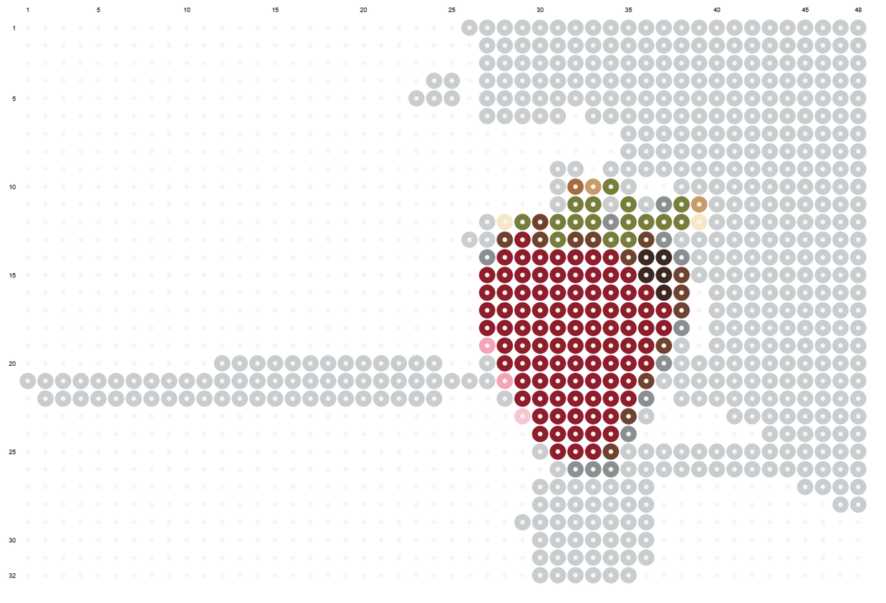

# 照片转拼豆图纸

一张照片可以有成千上万种颜色，做拼豆时手边只有一盒固定色号。我写了采样和配色程序，把照片缩成网格，在 Lab 色彩空间里寻找接近的色号，再逐色统计需要多少颗。透明格留空，大图可以分区打印。

## 一张图纸需要多少颗豆子

这张图来自原工程的草莓样例。面积采样后，程序把照片映射到 48 × 32 的网格，再为每格分配色号。材料表里合计 12 种颜色、1,536 颗豆子，其中白色 908 颗、浅灰色 479 颗。按每种颜色分别加 10% 余量并向上取整，总备料是 1,697 颗。最终可导出编号图、材料清单和分区打印页，制作时按坐标拼接。原始样例照片由 Marta Nogueira 拍摄。[样例照片来源](https://www.pexels.com/photo/vibrant-succulent-strawberry-isolated-on-white-background-space-for-text-health-nutrition-and-healthy-eating-concept-19546183/)

## 运行一个最小例子

在本目录运行 `node demo.cjs`。四个输入像素里有两个红色、一个蓝色和一个透明像素。程序核对用量后生成 `outputs/pattern.svg`，可以在浏览器中打开。

[采样、量化与备料算法](core.js) · [示例输入与断言](demo.cjs)
