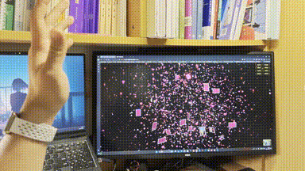

# 用手势控制屏幕上的粒子

这段无声实录把我的手和显示器拍在同一个画面里。张掌时粒子散开，握拳后粒子重新聚成树形。可以直接观察动作与响应的先后。

浏览器通过摄像头取得画面，MediaPipe Hand Landmarker 给出手部关键点。我用腕点到掌部关键点的距离估计手掌尺度，再与指尖到腕点的距离作比较。手靠近镜头时，阈值会随画面里的手一起放大。手的位置还控制场景旋转，主题切换设有时间间隔，以免保持同一手势时反复触发。粒子和灯光由 Three.js 绘制。

[原网页程序](src/index.html) · [张掌原帧](assets/hand-open.jpg) · [收掌原帧](assets/hand-closed.jpg)

下载项目后，在项目目录运行 `python -m http.server 8000 --bind 127.0.0.1 --directory src`，再在浏览器地址栏输入 `http://localhost:8000` 并允许摄像头。首次打开需要网络加载网页库和关键点模型。

[图像处理与摄像头识别](../../collections/imaging/) · [作品集首页](../../)
