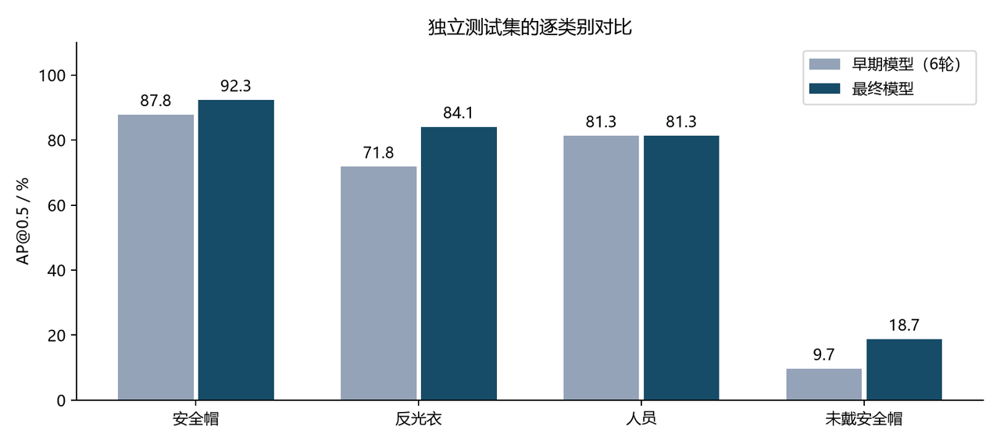

# 施工现场的人员与安全装备检测

要回答“谁的安全帽可能缺失”，要先找到人员，再把安全帽、反光衣与画面中的人对应起来。我在 Construction-PPE 数据上选取四类标注，用 YOLO26n 微调 20 轮，再根据装备框与人员框的覆盖程度和上下位置做关联。安全帽与未戴帽迹象冲突时，程序会保留“需复核”的状态。



最终模型的安全帽 AP50 为 92.3%，疑似未戴帽只有 18.7%。两类的差距决定了这个结果适合作为人工复核的线索。逐类图同时给出了反光衣和人员的结果。

[训练曲线原表](results/training.csv) · [人员与装备的关联实现](src/engine.py) · [训练脚本](src/train.py) · [最终部署模型](models/final.onnx)

[Construction-PPE 数据说明](https://docs.ultralytics.com/datasets/detect/construction-ppe/) · [Ultralytics 及项目源码许可](LICENSE-AGPL-3.0.txt)

## 在自己的照片上试用

在本项目目录安装推理依赖，再运行单图入口。程序在 CPU 上读取图片，把坐标和预测写到终端。

```sh
python -m pip install -r requirements.txt
python src/predict.py photo.jpg
```

[机器学习项目](../../collections/ml/) · [作品集首页](../../)
