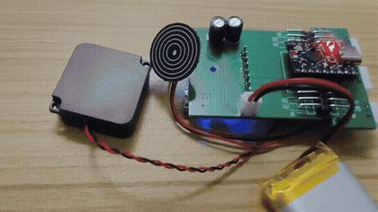
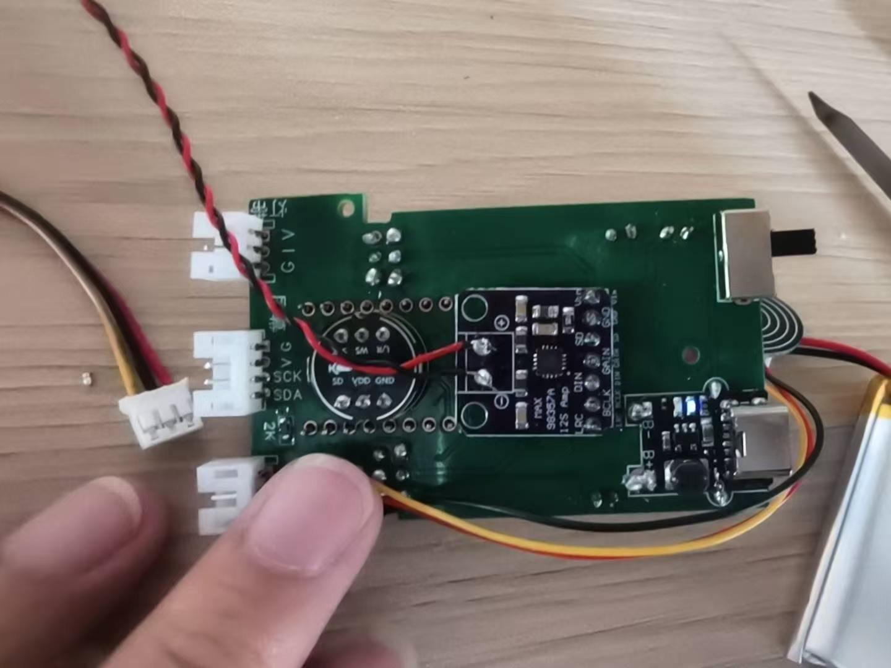
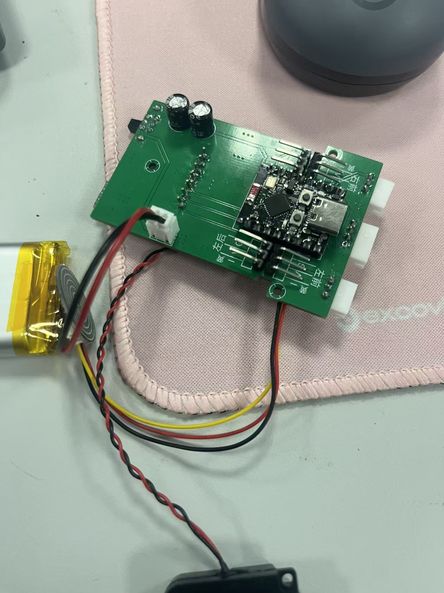
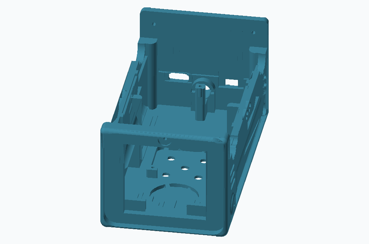
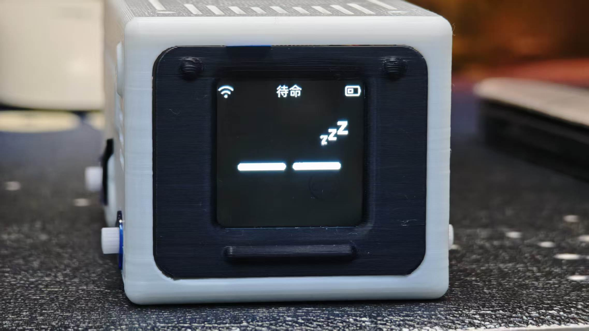

# 从 STM32 桌宠到 ESP32-S3 语音交互终端

第一台桌宠要能抬腿、站稳、显示表情。做 PowerPet 时，我给屏幕换了一个任务：让坐在桌边的人看到 UPS 的状态。后来我用 ESP32-C3 尝试联网对话，又在 ESP32-S3 毕设里把 LCD 和语音服务放进同一台设备。

| 阶段 | 我在这一版解决的问题 | 展示材料 |
| --- | --- | --- |
| [STM32 桌宠](#stm32) | 调整打印件和舵机角度，让四条腿按预期动作 | [装配实拍](../../collections/embedded/assets/desktop-pet.jpg) |
| [PowerPet 交互端](#powerpet) | 接收 UPS 后台数据，在桌面端轮换显示 | [交互端分工与显示逻辑](#powerpet) |
| [ESP32-C3 桌宠](#esp32-c3) | 在接入小智语音的方案上做板级调试，观察触摸输入的反馈 | [板卡实拍](assets/c3-board-front.jpg) · [触摸调试录像](https://raw.githubusercontent.com/mozich-07/engineering-portfolio/main/projects/desktop-robot-evolution/assets/c3-touch-test.mp4) · [机身 STL](models/caiyudog-body-v49.stl) |
| [ESP32-S3 毕设](#esp32-s3) | 配置带 LCD 的语音终端，让设备状态在屏幕上可见 | [LCD 待命界面实拍](assets/s3-lcd-standby.jpg) |

## STM32 桌宠的装配与动作调试

我用 STM32F103 驱动 1.3 英寸 OLED 和五个 SG90 舵机，其中四条腿使用 TIM2 的四路 PWM。左右舵机的安装方向相反，同一个抬腿动作要分别设置两侧的角度。打印件间隙太小也会卡住关节。我调整了结构配合和舵机角度，再把腿装回机身检查实际动作。[参考硬件方案](https://oshwhub.com/sngelswyh/stm32-smart-desktop-pet)

## PowerPet 的屏幕如何显示 UPS 状态

原先屏幕上的表情由桌宠自己控制。参加 PowerPet 便携式 UPS 项目后，我沿用桌宠作为交互端，负责接收后台检测数据、同步到屏幕，再轮换显示。这样，使用者在桌边就能查看 UPS 状态。团队其他成员负责 UPS 主电源。

## ESP32-C3 的接线与触摸调试

这一版参考了菜鱼狗的板级工程，将小智语音交互接入桌宠。我在装壳前把电池、主板和外设接在桌面上调试。录像里可以看到，手指接触圆形触摸板后，板上的蓝灯亮起。[观看 8 秒调试录像（静音）](https://raw.githubusercontent.com/mozich-07/engineering-portfolio/main/projects/desktop-robot-evolution/assets/c3-touch-test.mp4)

| 板卡正面 | 板卡反面与电池接线 |
| --- | --- |
|  |  |

整理机身时，我把实物接线与初版结构对照。下图是初版“菜鱼狗”身体部件 v49 的渲染图，打开 STL 可以转动模型，查看内侧支撑柱和壳体开口。[查看初版机身参考模型](models/caiyudog-body-v49.stl) · [菜鱼狗板级参考工程](https://github.com/Zohlz/xiaozhi-esp32-caiyudog)

## ESP32-S3 毕设的 LCD 与语音交互

到了毕设，我采用带 LCD 的 ESP32-S3 方案。除了匹配主板和固件，我还配置了小智设备与角色，并在屏幕上查看设备状态。C3 调试时可以看指示灯判断触摸有没有响应；S3 装好外壳后，从正面就能读到当前状态。照片里屏幕显示“待命”，上方可见无线连接和电池图标。

后续外设扩展涉及触摸、装饰灯带和风扇。音乐播放另有服务端工程，配置时还要考虑设备端与服务端如何配合。

[打开 LCD 实拍原尺寸图](assets/s3-lcd-standby.jpg) · [返回嵌入式与机器人](../../collections/embedded/)
