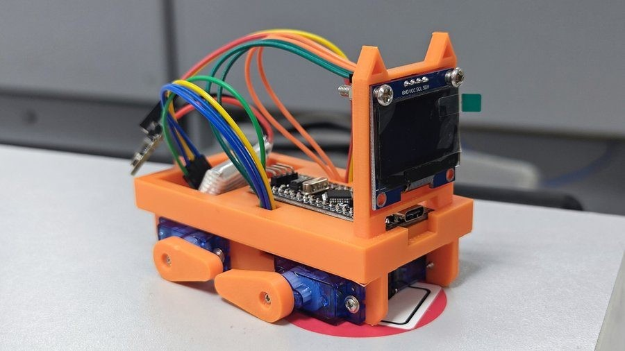

# 一台桌宠怎样变成设备交互端

最初做 STM32 桌宠时，我遇到的问题很具体：选哪颗芯片、打印件装不进去怎么办、四条腿怎样按预期动作。后来做 PowerPet，桌宠有了一个实际使用者——坐在 UPS 旁边、需要看设备状态的人。再往后，我把桌面机器人转到 ESP32-C3连接小智AI做对话，最终在 ESP32-S3 上做毕业设计。几次迭代延续的是同一个交互问题，各阶段用到的结构和固件有所提升变化。

| 阶段 | 这一版需要解决什么 | 可核对的成果 |
| --- | --- | --- |
| [STM32 桌宠](#stm32) | 让舵机、打印件和表情显示配合工作 | 实物照片、STEP 结构版本、PWM 与 OLED 工程记录 |
| [PowerPet 交互端](#powerpet) | 让用户在桌面上看到 UPS 后台状态 | 大创分工与个人开发记录，完成数据同步和轮换显示 |
| [ESP32-C3 桌宠](#esp32-c3) | 换主控后重新安排机身、动作与联网交互 | 初版目录的 19 个 STL 部件、C3 板级参考工程 |
| [ESP32-S3 毕设](#esp32-s3) | 在 LCD 版本上组织语音、屏幕、动作与服务配置 | LCD 主板工程、固件与烧录说明、小智配置入口、音乐服务代码包 |

## STM32：先解决装配和动作

我使用 STM32F103 芯片作为主控进行开发。正面是 1.3 英寸 OLED，四条腿和尾部共用五个 SG90 舵机。腿部使用 TIM2 的四路 PWM；左右舵机的安装方向相反，同一个抬腿动作需要分别处理两侧的角度。打印件的配合间隙过小也会妨碍装配。我在这版做了芯片适配、结构公差调整、舵机控制和状态显示，实际装起来后再对照动作检查。[上游硬件方案](https://oshwhub.com/sngelswyh/stm32-smart-desktop-pet)

## PowerPet：让屏幕显示设备真正关心的数据

原桌宠的屏幕用来显示表情和本机状态。参加 PowerPet 便携式 UPS 项目后，我沿用桌宠作为用户交互端，负责接收后台检测数据、同步到屏幕，并轮换显示。与播放预设表情相比，显示内容现在取决于另一台设备。我的工作集中在桌面端与数据展示；UPS 主电源由团队其他成员负责。

## ESP32-C3：重新考虑机身和交互接口

转到 C3 后，我开始围绕新板卡整理机身与外设布局。初版结构将身体、侧壳、腿、防滑件、耳和尾拆开保存。下图直接从归档中的身体 STL 渲染，可以看到壳体里的支撑柱、开口和安装孔。它是这一阶段的结构记录。

C3 阶段参考了菜鱼狗的板级工程。工程里将动作、OLED 表情和网页控制分别实现，Wi-Fi 提供了从浏览器发指令的入口。对我来说，这一步的变化是要一起考虑机身空间、板卡接口和指令来源。动作与语音固件的上游实现可在原项目查阅。[C3 参考工程](https://github.com/Zohlz/xiaozhi-esp32-caiyudog)

## ESP32-S3：把 LCD、语音配置和服务端放进毕设

最终毕设基于 ESP32-S3 + LCD显示屏 方案。另有烧录资料、小智设备与角色配置入口，以及配套音乐服务工程。到了这个阶段，单改舵机驱动可提升的效果已经达到了边界，所以开始进一步拓展了其他装饰LED灯带、触摸控制、风扇等拓展外设。这个过程中板卡和固件要匹配，语音交互涉及设备与服务端需要配置，显示和动作则在设备中需要呈现。

这段经历中，STM32 阶段留下了装配和控制问题，PowerPet 有明确的数据展示成果，C3 与 S3 阶段留下了结构、板图和集成资料。
