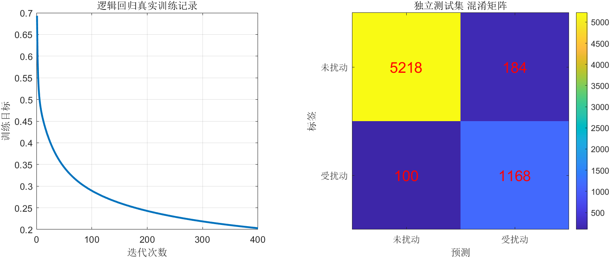
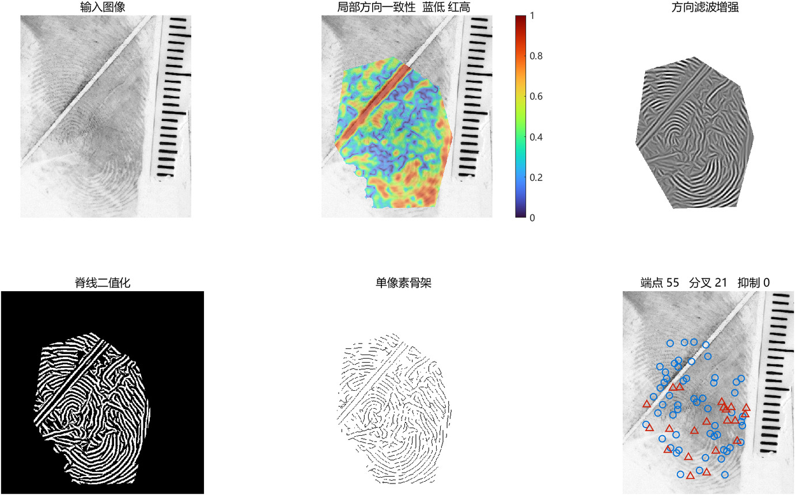
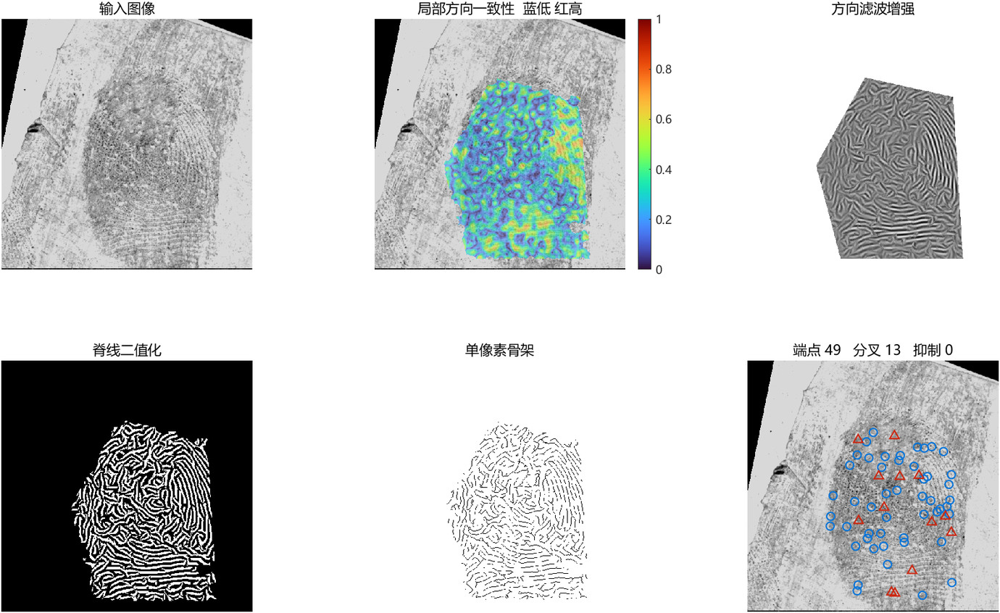

# 指纹纹线增强与细节点提取

指纹有灰尘、遮挡或模糊时，纹线中断会产生假的端点。我先做局部增强、二值化和骨架化，再用邻域交叉数找端点与分叉点，最后根据纹理质量筛选候选。质量评分分支还用带主观评分的数据训练回归树。

同为 48 个案例，清晰组每图平均有 33.42 个初始候选，筛后保留 30.75 个；灰尘组初始候选增至 47.27 个，筛后保留 23.04 个。这些数字记录了算法留下多少点。要评价位置是否准确，还需逐点对照标注。

[按干扰类型的统计](results/summary.csv) · [增强、筛选和细节点计算](src/fp_process.m) · [质量模型](models/) · [训练入口](trainRealQuality.m)

在 MATLAB 的项目目录执行 `addpath('src'); s = load('models/quality_model.mat'); r = fp_process('input.png',s.model);`。返回的 `r.skeleton` 是骨架图，`r.points` 给出候选及筛选标志。公开材料保留模型和汇总结果，真实指纹原图可按发布方条件取得。[SOCOFing 数据说明](https://arxiv.org/abs/1807.10609)

## 遮挡处为什么容易多出端点

沿遮挡边缘看，原本连续的纹线会中断。右下角把候选位置叠回图像，便于逐点复核。

颗粒还会形成短而碎的纹线。比较两幅图中候选点的分布，就能看出噪声怎样影响细节点提取。

[图像处理与摄像头识别](../../collections/imaging/) · [机器学习项目](../../collections/ml/) · [作品集首页](../../)
