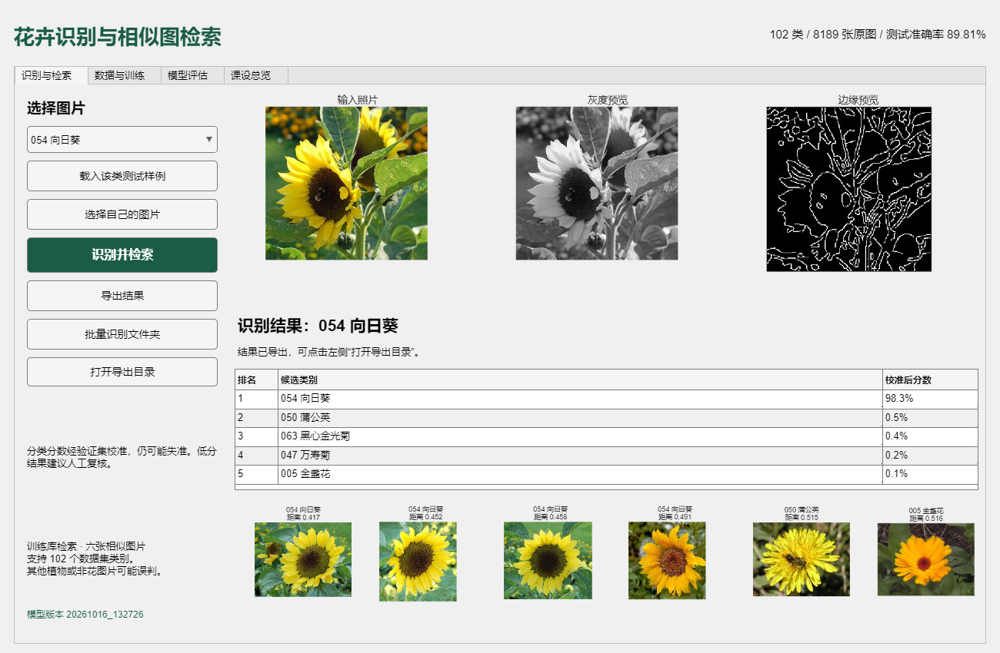
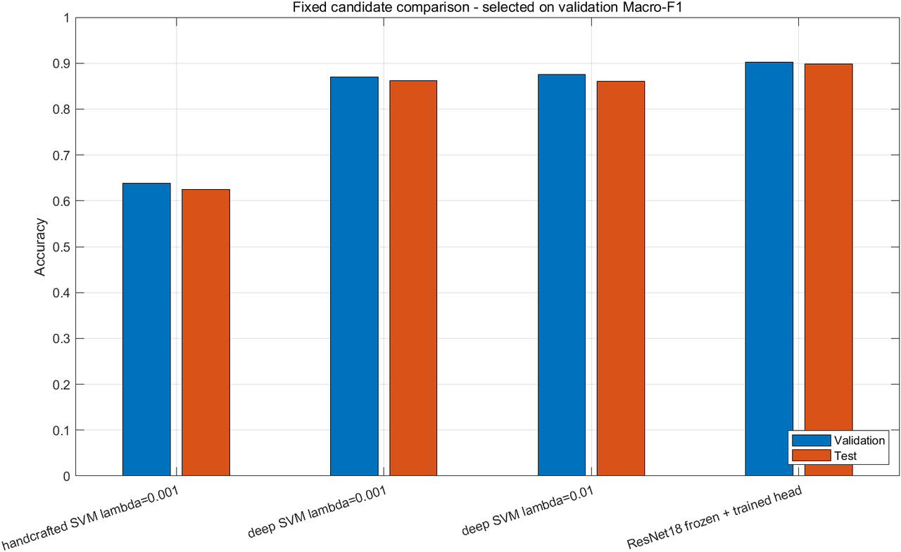
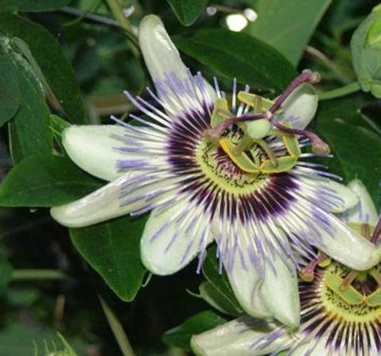
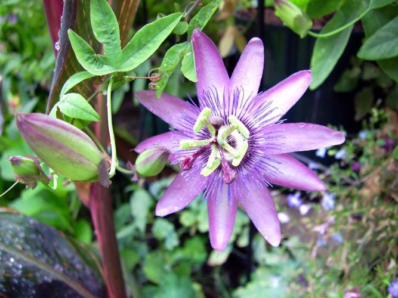

# 花卉识别与相似图片检索

两张花的颜色相近，类别就一定相同吗？我在 Oxford 102 Flowers 上把手工颜色、纹理特征与预训练 ResNet-18 特征放在一起比较。分类给出类别，相似图检索则返回便于目视对照的候选。两项输出回答的问题不同。

选择向日葵样例并点击“识别并检索”，界面把第 54 类向日葵列在首位。下方六张近邻里也有其他类别的黄花，可以直接比较花瓣、花盘和背景，理解哪些特征容易混淆。

验证集用于选择模型。测试集上，手工特征加 SVM 的准确率为 62.5%，冻结 ResNet-18 后训练分类头得到 89.8%。这两个数字评价分类；检索还需要观察返回图片的形状、纹理是否相近。

[模型对照原表](results/models.csv) · [各类别指标](results/per-class.csv) · [学习曲线](results/learning-curve.csv) · [训练入口](train_project.m)

在 MATLAB 中运行 `addpath('src'); f = fx_features('flower.jpg');` 可以直接提取一张照片的手工特征。[特征实现](src/fx_features.m) · [分类与检索](src/fx_predict.m)。训练深度分支还需要 Oxford 数据、官方划分、Deep Learning Toolbox 和 ResNet-18 参数。工程沿用 MathWorks 的网络定义，参数放入 `models/pretrained/resnet18Params.mat`。[数据与划分](https://www.robots.ox.ac.uk/~vgg/data/flowers/102/) · [预训练参数](https://www.mathworks.com/supportfiles/nnet/data/networks/resnet18Params.mat) · [网络实现及许可](third_party/resnet18/)

## 同是西番莲，分类结果也会不同

这一张被归到第 77 类西番莲。

另一张同类花朵却被归到第 92 类 bee balm。照片中花瓣与放射状结构都有明显变化。

[机器学习项目](../../collections/ml/) · [作品集首页](../../)
