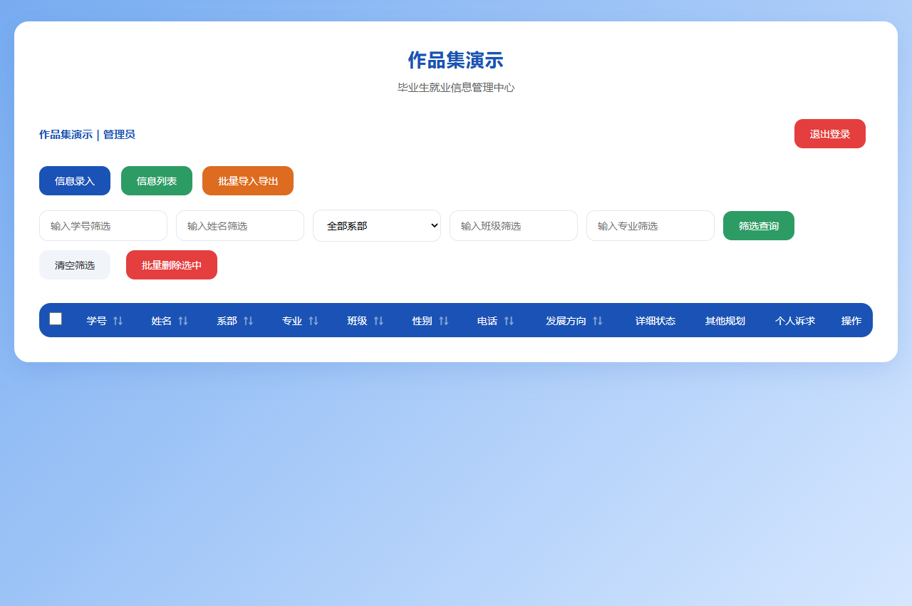

# 毕业生就业信息管理系统

我把分散在表格里的毕业去向整理成可筛选的网页。录入时选择升学、就业或其他规划，页面再展开对应字段。已有表格可以批量导入，页面按行检查缺项和重复学号；筛选后的记录可以导出 Excel 或 PDF。

[完整单页程序](src/index.html)包含录入、筛选、修改、批量导入和导出逻辑。下载后在浏览器打开，使用演示管理员 `000000`、密码 `123` 进入空表，可用虚构记录试填。记录保存在当前浏览器，表格和 PDF 导出依赖页面引用的在线库。

[软件工具](../../collections/software/) · [作品集首页](../../)
