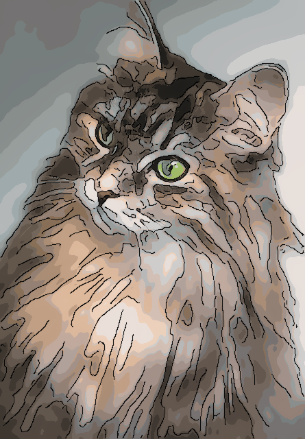

# 把照片变成漫画和素描

同一只猫的毛发，在漫画和素描里应该保留多少？我先做保边平滑，再提取轮廓、量化颜色，最后把线条与色块合成。漫画预设保留颜色，素描更突出线条。下面两张图来自同一张输入照片。

| 漫画 | 素描 |
| --- | --- |
|  |  |

[输入原图](examples/cat.jpg) · [样图署名与许可](examples/CREDITS.md) · [颜色数、边缘比例和耗时的实测表](results/measurements.csv)

在 MATLAB 运行 `addpath('src'); a = cartoon_process(imread('examples/cat.jpg'),cartoon_defaults('comic')); imshow(a.Result)`。可将 `comic` 改为 `sketch` 对照。原程序还提供[单张预览](run_project.m)、[批处理](run_batch.m)和[处理函数](src/cartoon_process.m)。

[图像处理与摄像头识别](../../collections/imaging/) · [作品集首页](../../)
