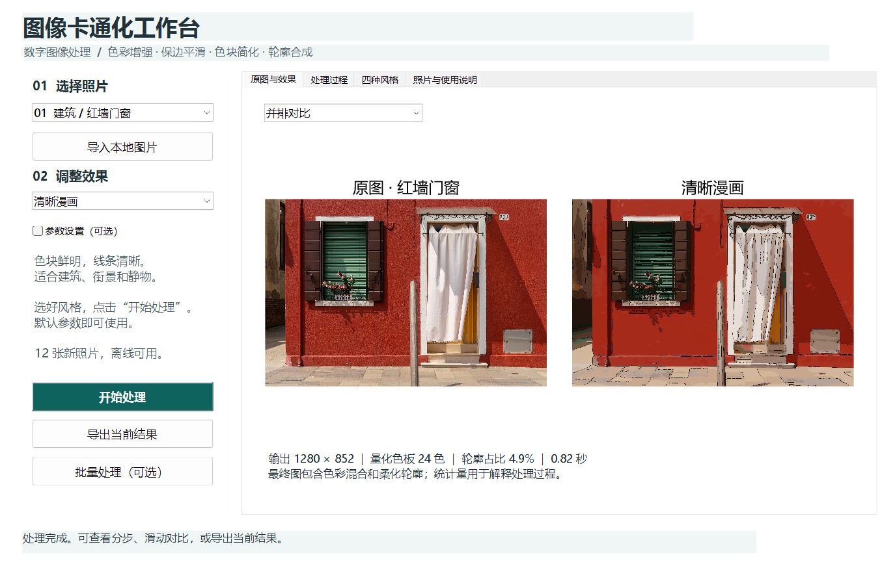
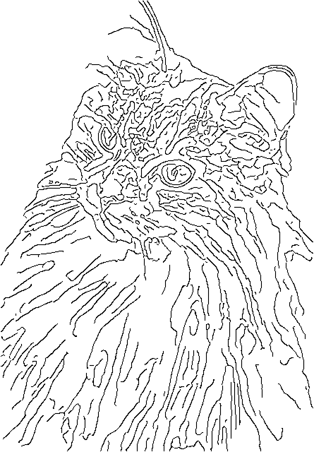
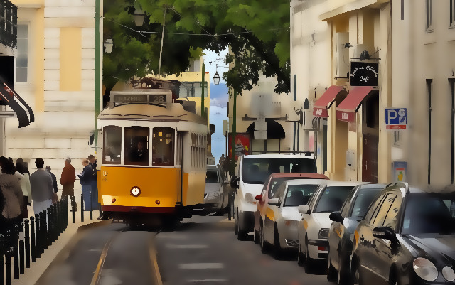
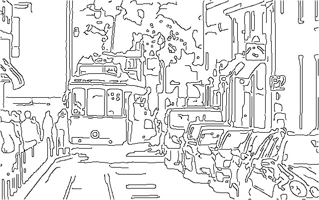
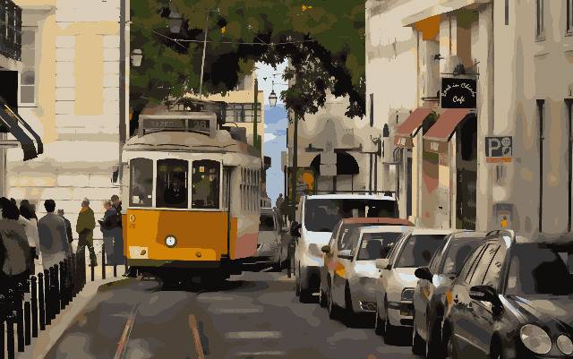
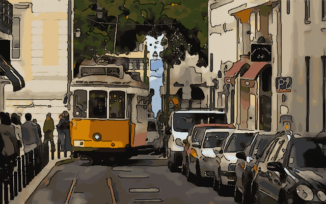

# 把照片变成漫画和素描

同一只猫的毛发，在漫画和素描里应该保留多少？我先做保边平滑，再提取轮廓、量化颜色，最后把线条与色块合成。漫画预设保留颜色，素描更突出线条。后文用同一张长毛猫照片比较这两种预设。

工作台中选“红墙门窗”和“清晰漫画”，白色窗帘的褶皱被归并成几块明暗区域，窗框和门沿仍然清楚。这张图记录的是导出之前的预览状态。[工作台样图署名](examples/CREDITS.md)

| 漫画 | 素描 |
| --- | --- |
|  |  |

[输入原图](examples/cat.jpg) · [样图署名与许可](examples/CREDITS.md) · [颜色数、边缘比例和耗时的实测表](results/measurements.csv)

在 MATLAB 运行 `addpath('src'); a = cartoon_process(imread('examples/cat.jpg'),cartoon_defaults('comic')); imshow(a.Result)`。可将 `comic` 改为 `sketch` 对照。原程序还提供[单张预览](run_project.m)、[批处理](run_batch.m)和[处理函数](src/cartoon_process.m)。

## 街道电车的线条和色块

| 保边平滑 | 提取轮廓 |
| --- | --- |
|  |  |
| **颜色量化** | **漫画合成** |
|  |  |

看黄色车身最直观：颜色量化把相近的黄合到一起，轮廓图则保留车窗边界。两者叠回后，车身简化了，窗格仍然清楚。系列图是原工程保存的处理步骤。[样图来源与许可](examples/CREDITS.md)

[图像处理与摄像头识别](../../collections/imaging/) · [作品集首页](../../)
