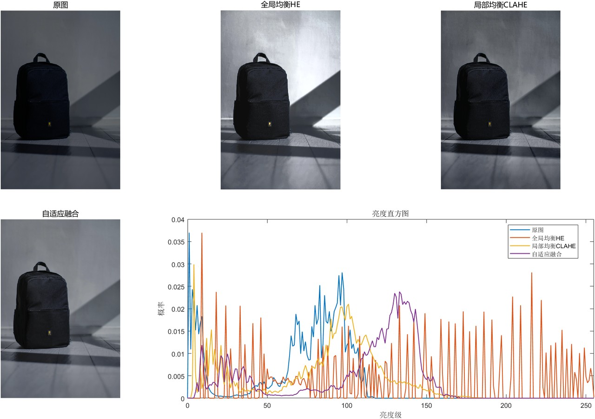

# 暗光照片的直方图增强

暗处的背包轮廓很难辨认。全局均衡能拉开亮度，局部均衡则可以限制局部对比度。我用同一输入比较两种处理，又记录亮度、熵、截断像素比例和色度变化，检查放大暗部细节时付出了什么代价。

背包案例中，原图的平均亮度为 0.262，全局均衡后为 0.508，CLAHE 为 0.324。访客可从结果表切换到其他场景，观察同一方法的效果是否一致。

[逐图指标](results/summary.csv) · [亮度通道与直方图处理](src/enhanceImage.m) · [MATLAB 工程文件](src/)

对自己的照片执行 `addpath('src'); r = enhanceImage(imread('photo.jpg')); disp(r.Metrics)`。各方法图像与名称分别在 `r.Images` 和 `r.Names`。

[图像处理与摄像头识别](../../collections/imaging/) · [作品集首页](../../)

[打开 13 组处理案例](examples/) · [照片来源与许可](examples/sources/cases.json)。在 MATLAB 执行 `run("src/start_project.m")` 可以切换内置案例，也能导入自己的照片。
