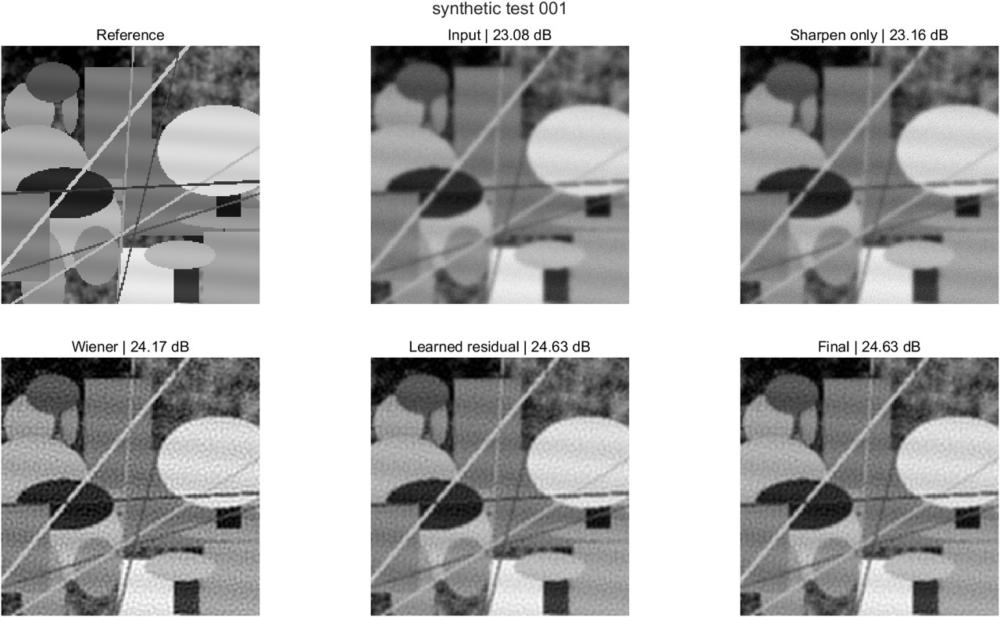

# 图像锐化与模糊复原

我把同一张清晰参考图退化后，分别尝试直接锐化、维纳复原和残差岭回归。把清晰图留在旁边很重要：锐化可以让边缘更醒目，也可能把噪声一起放大。



180 个案例中，残差模型将平均 PSNR 从 23.79 dB 提高到 25.77 dB，平均 SSIM 从 0.751 变为 0.746。均方误差减小，结构相似度却略有下降。下面的同一案例保留了输入、参考和每一步的输出。

[单个原始案例的七张图](examples/) · [按数据域汇总的指标](results/summary.csv) · [维纳复原与残差模型实现](src/+restorelab/) · [已训练参数](models/restoration_model.mat)

在 MATLAB 中用自选高斯退化参数比较三种方法：

```matlab
addpath('src')
m = restorelab.load_model(restorelab.config(pwd));
ref = im2double(imread('examples/reference.png'));
p = struct('kind','gaussian','strength',1.5,'angle',0);
b = restorelab.degrade(ref,p,0.01,1);
out = restorelab.process(b,p,0.01,m,[],ref);
imshow(out.final)
```

[图像处理与摄像头识别](../../collections/imaging/) · [机器学习项目](../../collections/ml/) · [作品集首页](../../)

[复原训练与评估入口](run_all.m) · [样图来源与许可](data/external/SOURCES.json) · [复用实现及样图库许可](third_party/)
