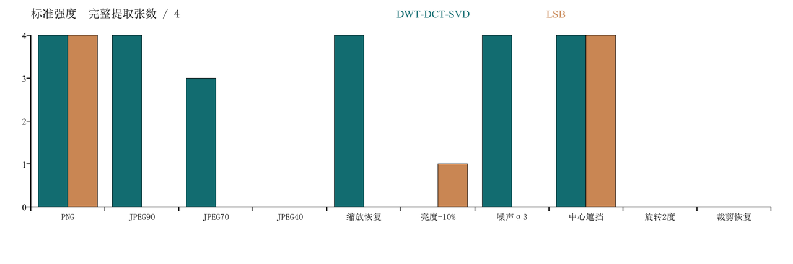

# 图像盲水印：嵌入后还能读回文字吗？

我分别用 DWT-DCT-SVD 和像素最低有效位 LSB 嵌入文字，记录嵌入造成的图像误差，再把图片经过压缩等处理，检查能否读回原文。盲提取只使用处理后的图片和约定参数；解码时通过校验码判断数据是否完整。



[不同处理条件的对照图](assets/robustness.png) · [编码、嵌入、提取与指标实现](src/core.py) · [回归检查](src/verify.py)

安装依赖后，可用随附的程序绘制样图做一次文字往返。变换域部分使用 MIT 许可的 blind-watermark 0.4.4。[上游实现](https://github.com/guofei9987/blind_watermark)

```sh
python -m pip install -r src/requirements.txt
python src/watermark.py embed src/samples/campus.png hello marked.png
python src/watermark.py extract marked.png
```

[图像处理与摄像头识别](../../collections/imaging/) · [作品集首页](../../)
