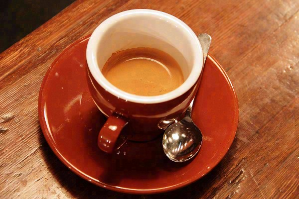
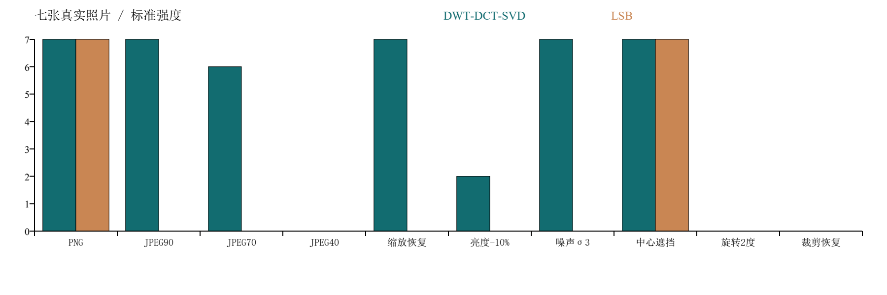

# 图像盲水印：嵌入后还能读回文字吗？

我分别用 DWT-DCT-SVD 和像素最低有效位 LSB 嵌入文字，记录嵌入造成的图像误差，再把图片经过压缩等处理，检查能否读回原文。盲提取只使用处理后的图片和约定参数；解码时通过校验码判断数据是否完整。

| 原始照片 | 嵌入文字后 | 再经 JPEG 压缩（质量 90） |
| --- | --- | --- |
|  |  |  |

三张图肉眼很难区分。这个样例嵌入后的 PSNR 是 38.23 dB，压缩后是 33.89 dB，两次都完整读回了文字；实际提取结果比肉眼观察更能说明水印是否留存。原演示使用 scikit-image 的咖啡样图。



旋转 2° 或裁剪后恢复尺寸，两种处理下变换域方法均为 0/7 成功。几何位置一变，提取时就难以对齐嵌入时的分块。[编码、嵌入与提取实现](src/core.py) · [回归检查](src/verify.py)

安装依赖后，可用随附的程序绘制样图做一次文字往返。变换域部分使用 MIT 许可的 blind-watermark 0.4.4。[上游实现](https://github.com/guofei9987/blind_watermark)

```sh
python -m pip install -r src/requirements.txt
python src/watermark.py embed src/samples/campus.png hello marked.png
python src/watermark.py extract marked.png
```

[图像处理与摄像头识别](../../collections/imaging/) · [作品集首页](../../)
