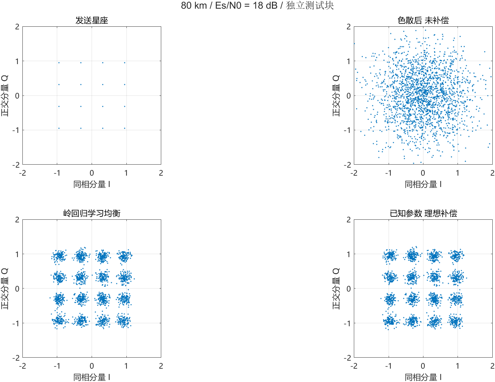
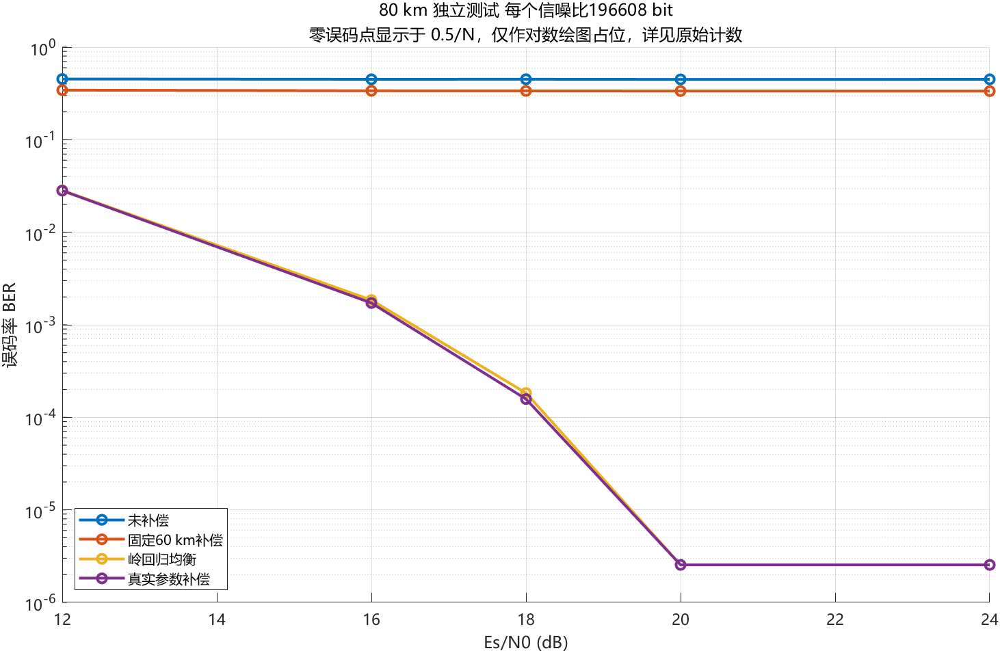
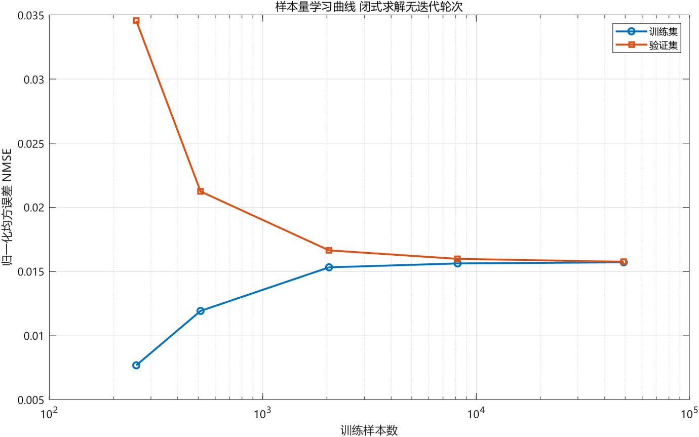

# 16QAM 光纤链路的色散补偿

相邻符号受色散影响后，接收端的星座点会散开。我把接收符号周围的 I/Q 分量作为输入，用岭回归估计中心符号。先按独立随机种子生成训练、验证和测试块，然后在验证块上选择窗口长度和正则化系数。



在 80 km、12 dB 条件下，未补偿 BER 为 0.4528，学习均衡后为 0.0284。冻结模型后改用 40 km、18 dB，BER 升至 0.4622。比较时要同时注明距离和信噪比，才知道模型面对的是哪一种信道。



[逐块误码数](results/test_per_block.csv) · [信道迁移原表](results/channel_shift_metrics.csv) · [选参记录](results/hyperparameter_search.csv) · [训练好的均衡器](results/trained_model.mat)

从本页目录在 MATLAB 运行以下命令，会重新生成信号、训练、出图，并核对误码率分母、随机种子和调制解调一致性。输出写入新目录。

```matlab
addpath('src')
output = tempname;
run_all(output);
test_project(output);
```

[信道及实验参数](src/fiber_config.m) · [岭回归训练](src/fit_ridge.m)

## 均衡器用了多少训练样本



横轴改变用于拟合的样本数。样本少时训练与验证误差相差较大，随着样本增加，两条曲线逐渐靠近。

[机器学习项目](../../collections/ml/) · [作品集首页](../../)
