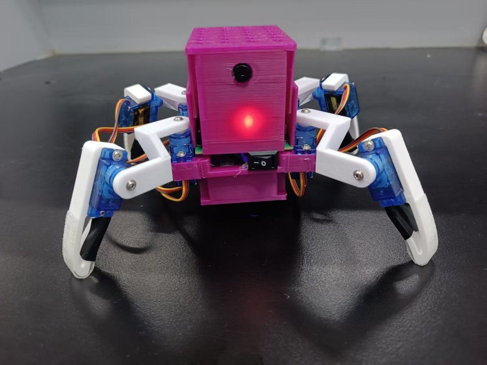
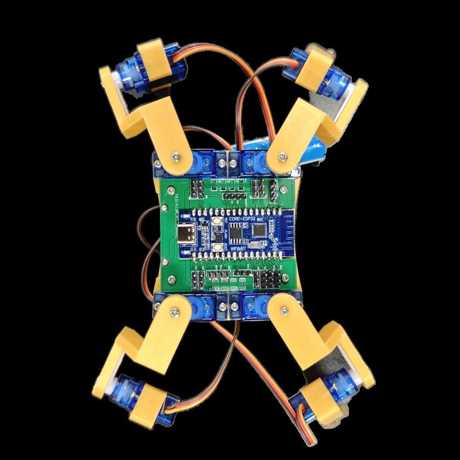
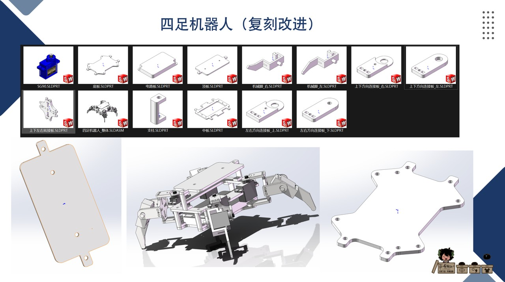

# 灵眸云控 · 四足巡检机器人

**2024.09–2025.05｜四人团队｜主控板、部分舵机控制与整机联调**

四条腿由八个 SG90 舵机驱动，机身上安装主控板和摄像头，操作端可以查看回传画面。我负责主控 PCB 绘制，参与舵机程序调试，并根据装配需要修改了部分打印件。团队完成单机原型，获得院第十一届计算机设计大赛一等奖。

| 装上外壳的样机 | 拆开上盖后的主控板和接线 |
| --- | --- |
|  |  |

## 主控板与八路舵机

我用嘉立创 EDA 绘制双层板，把 ESP32-C3、电源、WS2812B 指示灯和八路舵机接口布置在机身内，随后完成焊接、上电调试。俯视照片中，主板位于四条腿之间，舵机线从两侧接入。

舵机测试工程使用 PlatformIO、Arduino 框架和 ESP32_C3_ISR_Servo 库，配置了八个通道，脉宽范围为 500–2500 微秒。程序能向八路输出控制信号后，还需要在实物上检查回中位置、转动方向和连杆行程。我参与了这部分标定与基本动作联调。摄像头画面由团队的 Qt 客户端接收，客户端开发由其他成员完成。

## 从模型到装配

这张图保留了原建模记录里的“复刻改进”标注。上方是舵机、板件和安装件，下方是装配视图及局部板件。我的结构工作是在已有模型上做适配，让舵机、连杆和主控板能装进同一台样机。多足机器人集群课题沿用了这套原型，已完成的演示集中在单机运动和画面回传。

[八路舵机测试工程](servo-test/) · [实物引脚与脉宽配置](servo-test/src/main.cpp) · [计时器舵机库及作者说明](https://github.com/khoih-prog/ESP32_C3_ISR_Servo)
