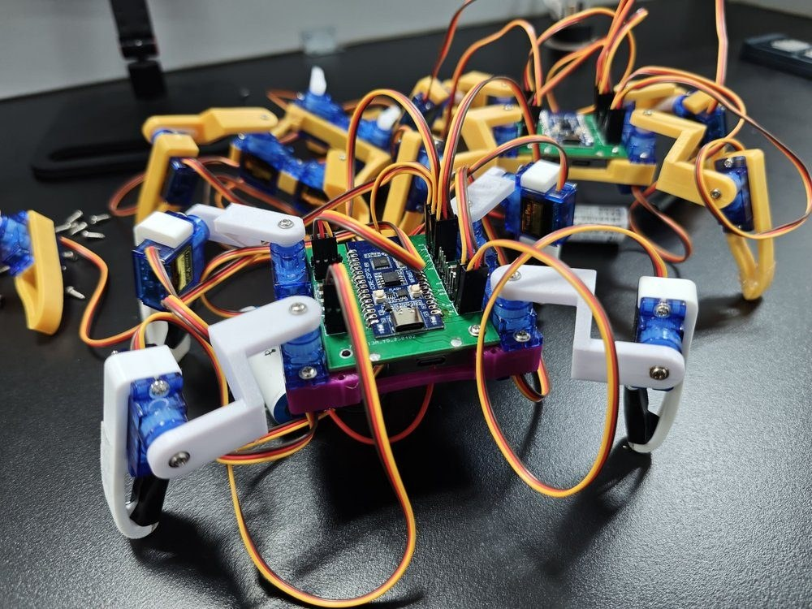

# 灵眸云控 · 四足巡检机器人

这是团队做的四足巡检原型，我负责双层主控 PCB、部分舵机控制和结构适配。样机完成了基本动作联调，团队获院计算机设计大赛一等奖。

## 从主控板到四条腿

我用嘉立创 EDA 画板，把 ESP32-C3、电源、WS2812B 和八路舵机接口放在同一块主控板上，完成焊接与上电调试。固件侧参与 PWM 控制、上电回中和角度标定。装配时用 SolidWorks 修改腿部打印件，让舵机安装位置和连杆配合起来。

拆盖图中可以看到八路舵机线束如何从主板分到四条腿。关联的多足集群课题沿用了这套单机原型。
