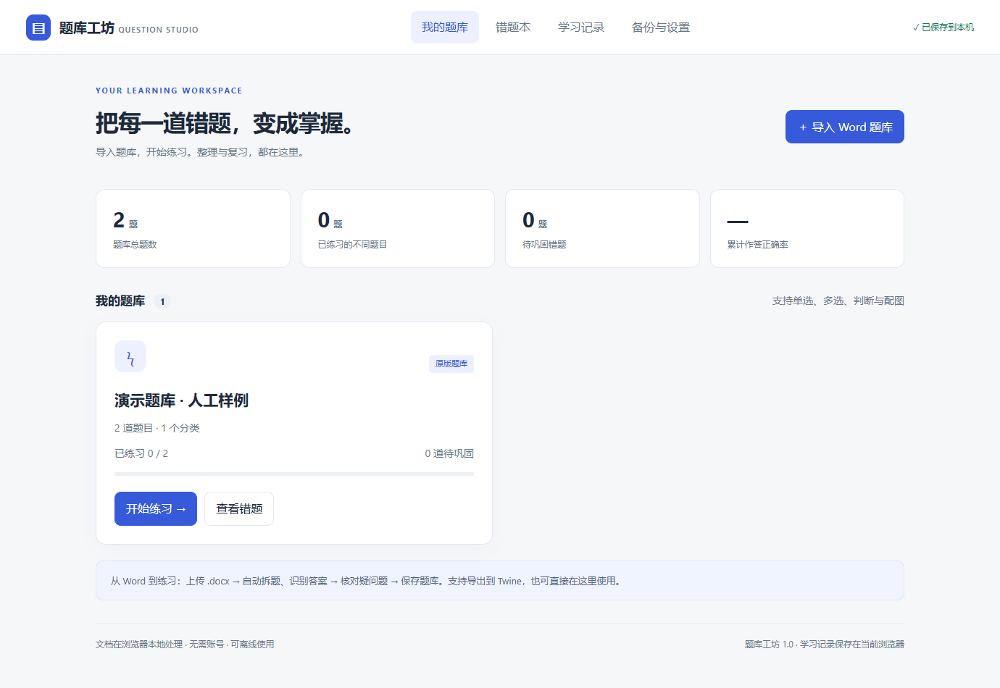
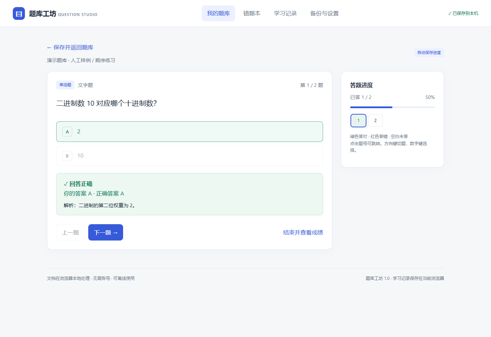

# 题库工坊 · 离线整理和练习 Word 题库

整理题库最费时间的地方是核对：有的文档把答案放在最后，有的多选题缺答案，还有重复题的答案互相冲突。我写了导入、核对、计分和错题复习流程，让这些问题在开始练习前就能被看到。练习和复习都在本地浏览器里完成。

## 本地运行

需要 Python 3 与 Node.js，在本项目目录运行：

```text
python work/build.py
node work/engine.test.cjs
node work/export.test.cjs
```

用桌面浏览器打开生成的 `outputs/题库工坊.html`。此目录只带人工编写的演示题，不包含原题集、试题配图、导出成品或用户记录。

代码分为解析/计分引擎、界面和构建脚本。第三方 Mammoth.js 供 Word 解析，SugarCube 仅用于 Twine 兼容测试；两者许可见 `work/`。

## 演示画面





## 测试覆盖

引擎测试覆盖多选计分、跳题分母、答案冲突、图片归属和重复题检查，另有 Twine 导出的往返测试。
