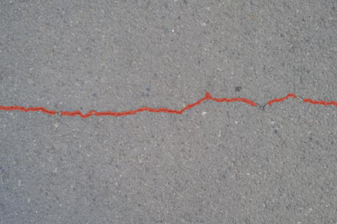
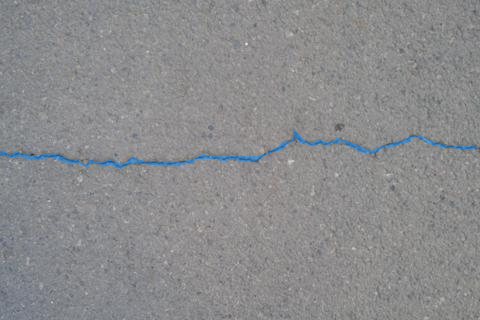
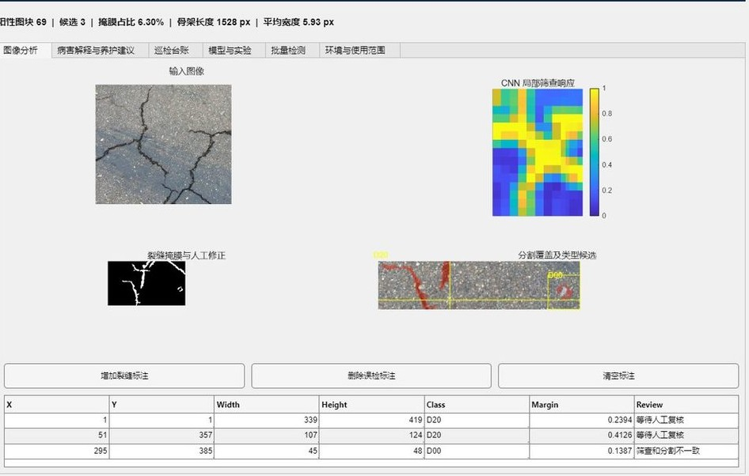

# 道路裂缝检测与形态分类

我用 MATLAB 完成数据划分、训练、模型比较和交互演示。想解决的问题有三个：一小块路面有没有裂缝，裂缝经过哪些像素，以及给定区域是什么形态。对应的测试单位分别是图块、像素和区域，因此每项任务单独评价。

同一张照片裁出的相邻图块常有相同的纹理。我先将 CrackForest 的 118 对图像与标注按原图划分，再在各组内裁块。这样可以避免模型在测试时再次看到训练道路的相邻区域。

## 一张测试图如何判读

| 模型输出，红色为预测像素 | 人工标注，蓝色为参考像素 |
| --- | --- |
|  |  |

两图取自原工程的 C01 演示案例，对应 CrackForest 测试图 010。模型找到了裂缝的主要走向，但线条的宽度、位置与标注仍有差异。逐像素比较，命中 1,684 个、误报 820 个、漏报 269 个，本图 IoU 为 0.6073。下表中的平均 IoU 汇总了全部 34 张测试图。

交互界面把图块置信度、分割叠图和候选区域放在同一屏。使用者可以查看候选框和类型，再逐项复核。上图是另一张输入的界面记录。

## 从一个图块到一张路面照片

| 问题 | 测试单位与方法 | 原实验结果 |
| --- | --- | --- |
| 一个图块里有裂缝吗？ | 34 张测试图派生 544 个图块，比较 TinyCNN 和 HOG + SVM | F1 分别为 0.8367 和 0.6575。换到外部样本后分别为 0.7610 和 0.7902，排序反转 |
| 裂缝覆盖了哪些像素？ | 12 通道特征与 40 棵树的随机森林，对 34 张图分别计算 IoU | 平均 IoU 为 0.3233；把所有像素汇总计算得到 0.3498 |
| 给定区域属于哪种形态？ | 480 个裁剪区域，HOG 与随机森林 | 分类准确率 82.5%，宏平均 F1 为 0.8264 |
| 能否在整图中找到裂缝并判对类别？ | 60 张图、171 个标注框，定位阈值 IoU 0.3 | 同时定位并分类正确的召回率仅 2.92%，候选框生成是后续改进重点 |

## 复算结果

在 MATLAB 中切换到此目录，运行 `verify_results`。脚本从 TP、FP、FN 复算图块 F1 和逐图 IoU，再与历史汇总表核对。无需下载路面照片或模型权重。同时提供[原像素分割算法](+crack/analyze.m)、[训练好的随机森林](models/pixel_forest.mat)及[Frangi 滤波代码和上游许可](third_party/frangi/)。在本目录执行 `setup_project; [model,p] = crack.loadModel(pwd); r = crack.analyze("road.jpg","fusion",p,model); imshow(r.overlay)` 即可把分割结果叠回自己的照片。加载分类器需要 Statistics and Machine Learning Toolbox，图像处理需要 Image Processing Toolbox。

- [图块筛查与外部数据对照](results/classification_summary.csv)
- [逐图分割结果](results/test_per_image.csv) · [各方法汇总](results/test_summary.csv)
- [裁剪区域分类](results/type_test_summary.csv) · [整图流水线](results/pipeline_summary.csv)
- [指标实现](+crack/metrics.m) · [复算脚本](verify_results.m)
