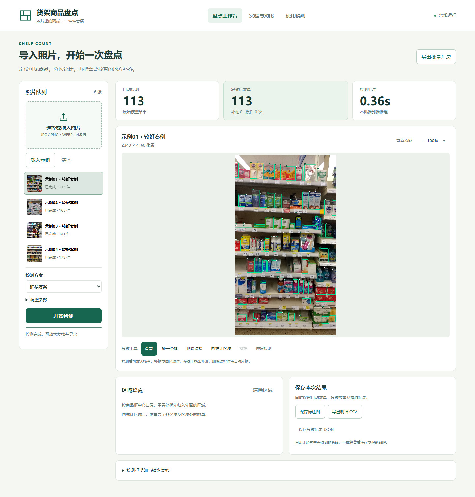
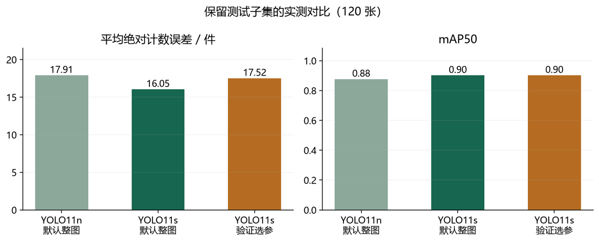
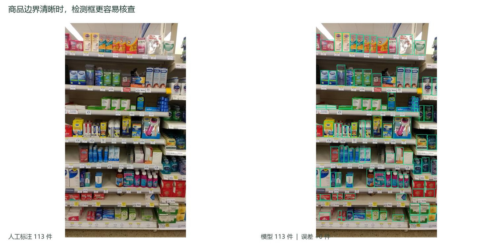
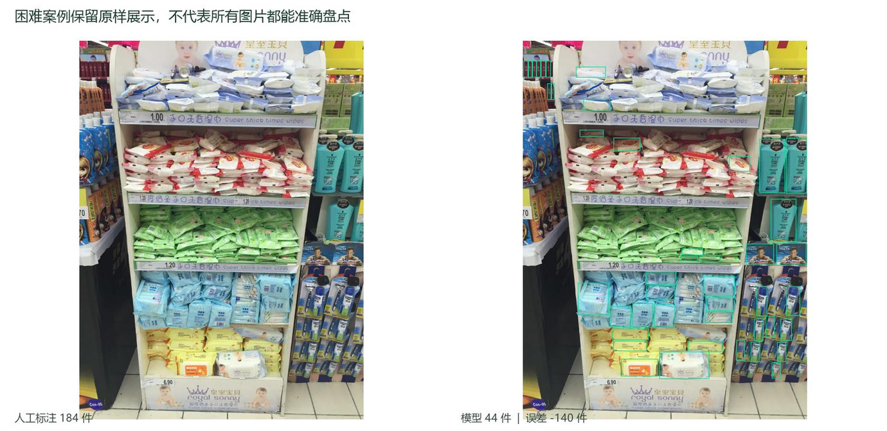

# 货架商品盘点：整图还是切块？

货架上的包装密集且外形相似。我用公开的 SKU-110K 检测模型做盘点，在推理端比较两条路径：整图缩小后检测，或者将货架分成有重叠的区域逐块检测，再按中心位置归属并去重。我的工作集中在推理、计数和逐图复核，上游发布者负责权重训练。



示例货架自动检出 113 件，复核后仍为 113 件。放大货架可以沿层板逐排看框；遇到漏框或重复框，工作台支持补框和删框，并保留修订前后的数量。



固定置信阈值 0.25，在同一批 120 张图上，整图每图平均绝对误差为 16.05 件，切块为 20.18 件。放大局部虽然能看见更小的包装，也会改变边界处的检出和去重。逐图表保留件数偏多、偏少的方向，可以挑出差异大的货架查看。

[同阈值逐图对照](results/per-image.csv) · [不同模型的逐图结果](results/model-counts.csv) · [分组统计](results/summary.csv) · [切块和去重源码](src/engine.py)

## 复算与推理

仅复算计数误差时，直接使用 CSV 中的 `abs(predicted - reference)`，按阈值和模式取均值。运行原推理算法时，从上游直接取得已导出的 [YOLO11s ONNX](https://huggingface.co/chistopat/sku110k-yolo11-object-detector/resolve/ee1b8ac34eb3b68969ffa8165e50c43457fe4e35/weights/sku110k-yolo11-s640.onnx)，保存到本项目的 `models/shelf_s.onnx`。该文件与原工程使用的模型 SHA-256 一致，均为 `e8bc019d4241cf9486c4b6aaf50d51b652b3a0d641fce1189fbba12136794cd1`。安装 `requirements.txt` 后分别运行：

```sh
python src/predict.py shelf.jpg --mode full
python src/predict.py shelf.jpg --mode tiles
```

原工程使用的权重修订为 `ee1b8ac34eb3b68969ffa8165e50c43457fe4e35`。数据与模型由发布方提供，使用范围见其说明。[上游权重](https://huggingface.co/chistopat/sku110k-yolo11-object-detector/tree/ee1b8ac34eb3b68969ffa8165e50c43457fe4e35) · [SKU-110K 数据](https://github.com/eg4000/SKU110K_CVPR19) · [Ultralytics 许可](LICENSE-AGPL-3.0.txt)

## 从整张货架检查漏计的位置



这张图人工和模型都数出 113 件。两幅图并排后，还可以继续检查每个框是否对应同一件商品。



在这排紧挨着的包装中，部分商品没有独立检测框。总数的差值告诉我该回看哪张图，标注对照才显示漏在什么位置。

[机器学习项目](../../collections/ml/) · [作品集首页](../../)
