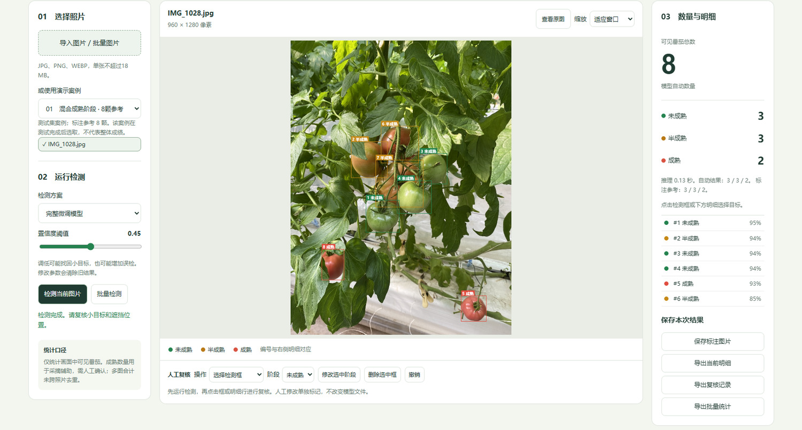
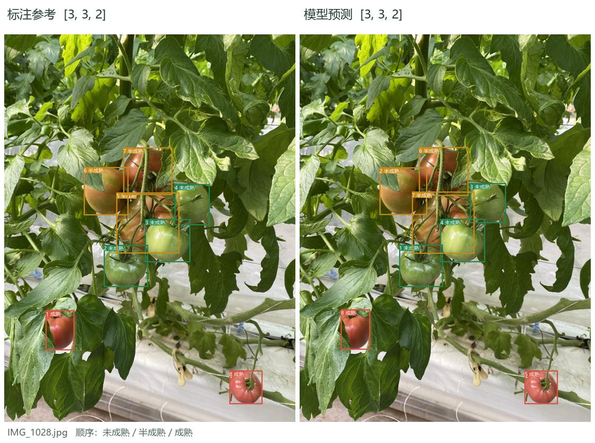
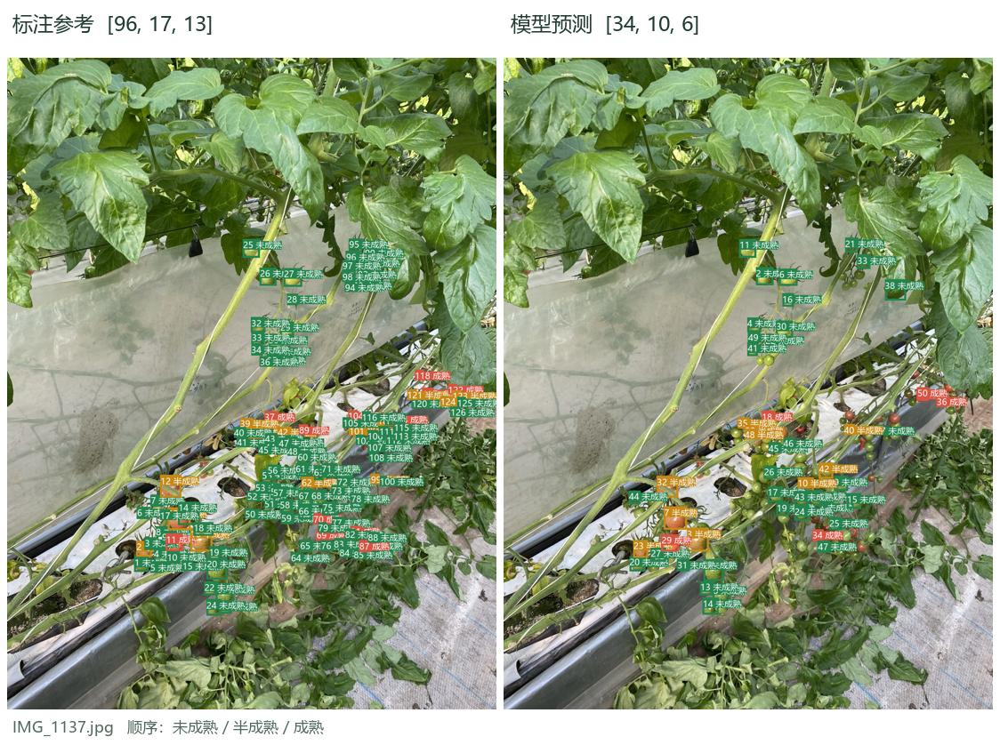
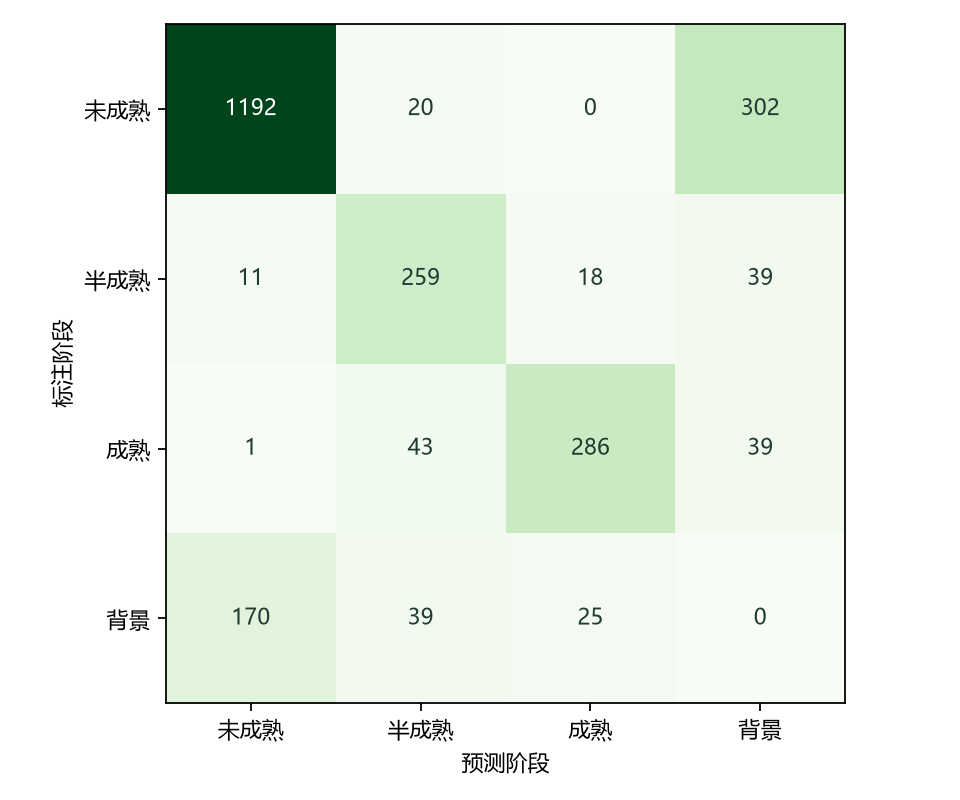

# 番茄成熟阶段检测与数量统计

一张照片里，果实可能被枝叶遮住，也可能已经被框出却被分错成熟阶段。我把 Laboro Tomato 标注映射为未成熟、半成熟和成熟三类，用同一批图比较基线和微调后的 YOLOv8n。



选一张照片，工作台会把果实框在原图上，并列出未成熟、半成熟和成熟三类的数量。下面两张对照图左侧是人工标注，右侧是微调模型的预测，均取自测试集。

**数对的例子 · IMG_1028**　人工和模型都数出 3 个未成熟、3 个半成熟、2 个成熟果实。可以沿着每个框逐颗核对。



**少计的例子 · IMG_1137**　人工标了 126 个，模型只数到 50 个。其中未成熟果实从 96 个少计到 34 个。叶片之间有许多又小又绿的果实，放大看能找到多个漏框位置。



## 整个测试集的表现



145 张测试图上，平均每图绝对计数误差从 3.77 个降至 2.48 个。逐图记录同时保留了三个阶段各自的参考数量和预测数量。一张图总数正确，也可以从这六列发现成熟度分错的情况。

[逐图及分阶段计数](results/per-image.csv) · [两种方案的汇总](results/summary.csv) · [微调记录](results/finetune-training.csv)

[原推理程序](src/engine.py)负责缩放、检测及坐标还原，[训练参数](src/train_original.py)记录了优化器和数据增强设置。公开版本带有[微调模型](models/finetune.onnx)。原照片及标注由 Laboro.AI 发布，使用 CC BY-NC-SA 4.0，模型基于 Ultralytics YOLOv8n。[数据来源](https://github.com/laboroai/LaboroTomato) · [模型许可](LICENSE-AGPL-3.0.txt)

## 在自己的照片上试用

在本项目目录安装推理依赖，再运行单图入口。程序在 CPU 上读取图片，把坐标和预测写到终端。

```sh
python -m pip install -r requirements.txt
python src/predict.py photo.jpg
```

[机器学习项目](../../collections/ml/) · [作品集首页](../../)
