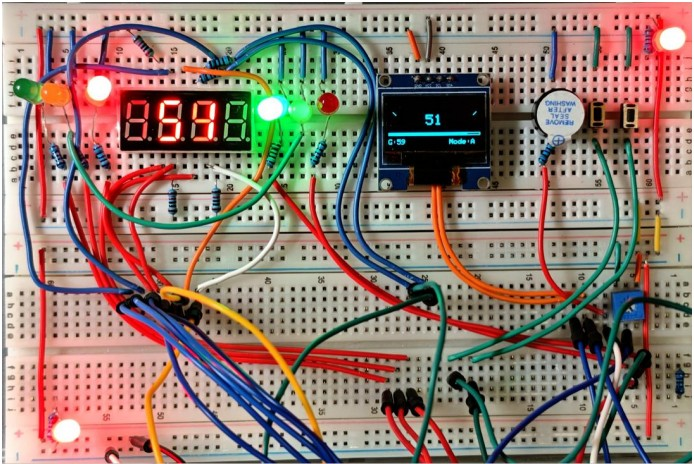
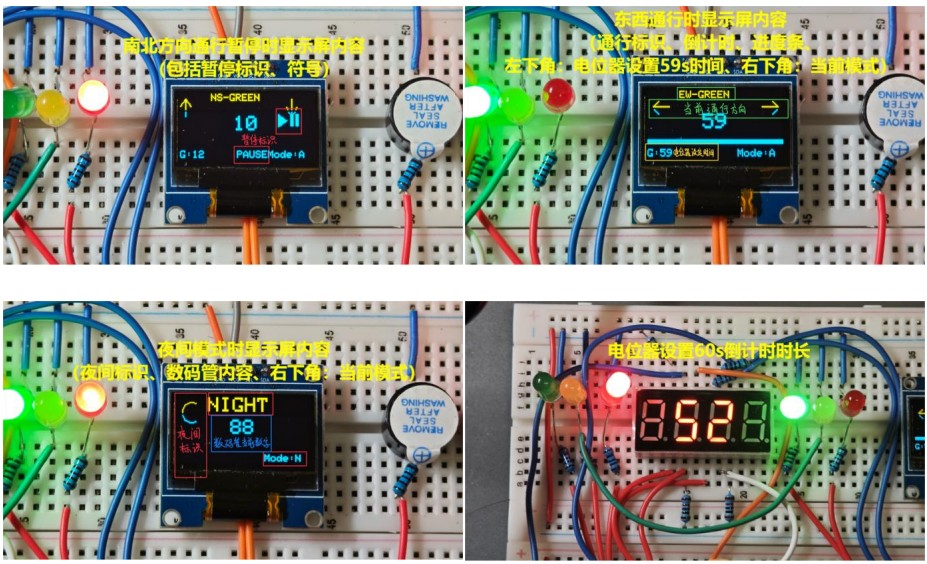

# 路畅 · 双向互斥交通灯

我用一块 Arduino Uno 制作双向路口的教学控制器，独立编写控制程序，完成了软件著作权登记。电位器调整放行时间，按键切换夜间黄闪或紧急双红。数码管负责倒计时，OLED 显示当前模式。

## 实物怎样工作

这是项目操作手册里的面包板样机。左侧数码管显示倒计时，中间的 OLED 给出运行状态；两组红、黄、绿灯模拟东西与南北方向。正常模式轮流放行，夜间模式使用共用黄灯，紧急模式点亮双向红灯并发出提示音。

上图保留了手册中的实际显示画面。以当前仓库的固件为准，K1 短按暂停或继续、长按复位，K2 短按切换夜间模式、长按进入约 5 秒的紧急模式；程序在松开按键时判定长短按，阈值为 1,200 毫秒。原操作手册将长按写为 1 秒，且个别灯脚编号与此版本不同。复现当前版本时请使用下表。

## 固件与接线

在本目录执行 `pio run -e uno` 即可编译。[查看 Arduino 草图](firmware/TrafficLightController/TrafficLightController.ino)。也可以用 Arduino IDE 打开草图，选择 Uno，安装 Adafruit GFX 和 Adafruit SSD1306。

| 信号 | Uno 引脚 | 台架观察点 |
| --- | --- | --- |
| 东西红、绿 / 南北红、绿 | D11、D13 / A0、A1 | 两个方向依次放行，记录相位交接时的实际灯态 |
| 共用黄灯 | D12 | 记录正常放行、过渡和夜间模式下的变化 |
| 暂停或重置 / 模式切换 | D0、D1 | 比较短按与长按；检查串口复用对下载的影响 |
| 电位器 / 蜂鸣器 | A3 / A2 | 比较两端位置的绿灯时长；观察紧急模式的提示与退出 |
| 倒计时 / OLED | D2–D8 段选、D9–D10 位选 / I²C 0x3C | 对照数码管与 OLED 记录倒计时及模式变化 |

两路黄灯共用 D12，两个按键占用串口引脚 D0、D1，下载程序时要注意外部接线。Uno 目标已通过自动编译；实机切换时序仍需台架测量。
