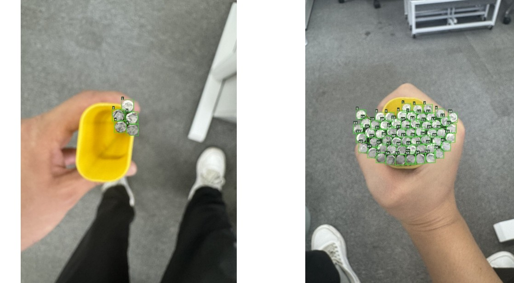
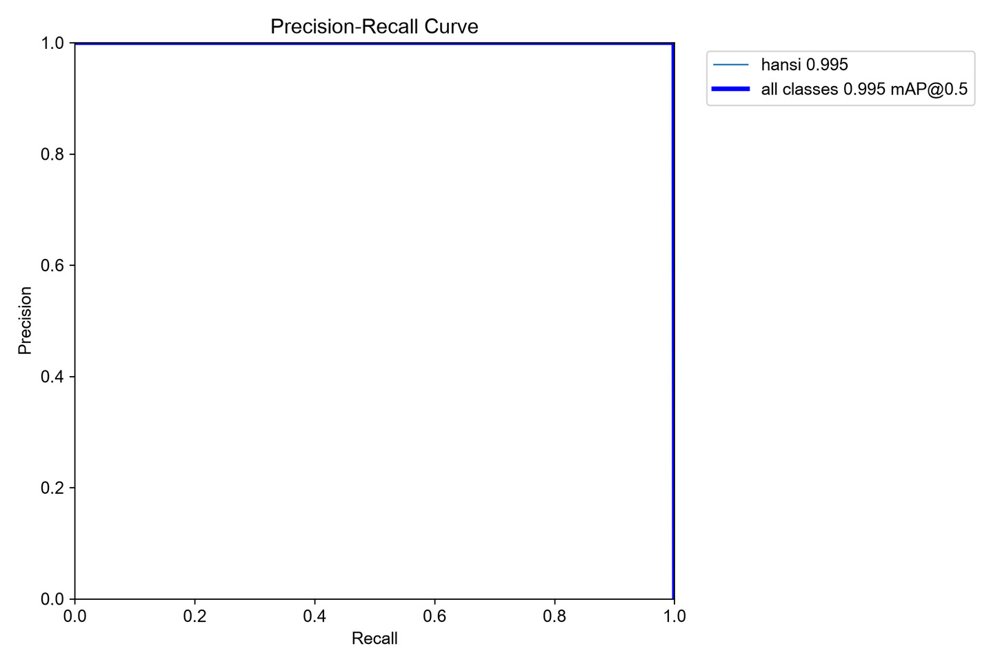
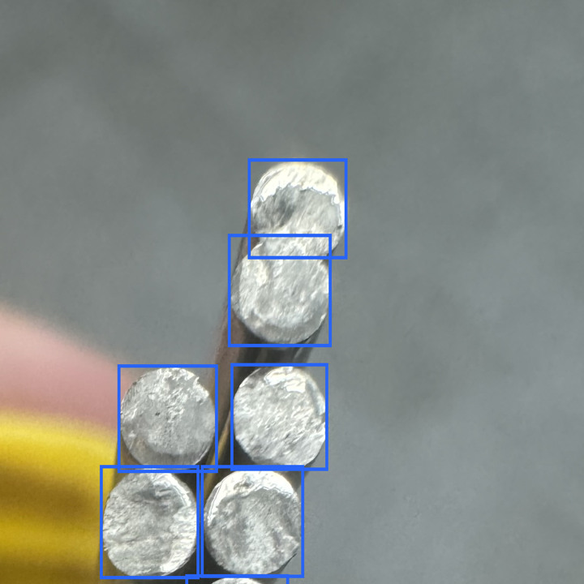
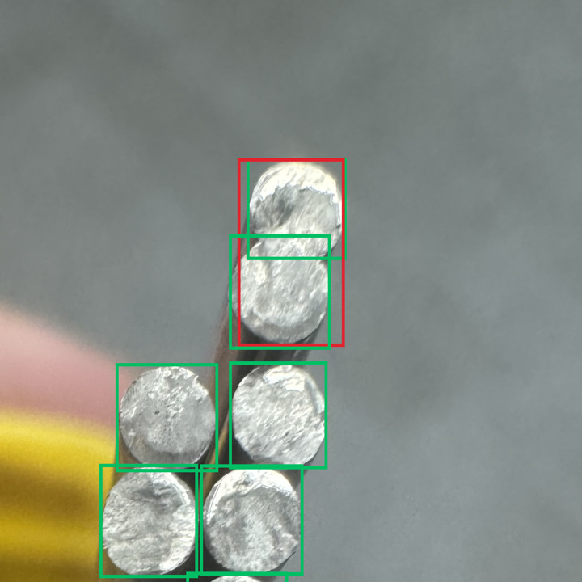

# 一束焊丝有多少根？

同一束焊丝从端面拍摄时，每根只占一个小圆点。在密集处，两个相邻端面容易被算成一个。我用 188 张训练图微调 YOLOv8n，再把模型导出为 ONNX，用 CPU 对同一批验证图重新计数。



密集案例的参考数量是 56，预测是 57。48 张验证图中有 46 张计数完全一致，平均每图差 0.0417 根。同一批图改用灰度预处理后，有 47 张计数一致，平均绝对误差为 0.0208 根。总数一致的图片仍可能同时出现漏检和多检，所以保留了框的位置和检测曲线。导出前后在这 48 张图上的计数一致。

[逐图计数与四种预处理对照](results/per-image.csv) · [100 轮训练记录](results/training.csv)

## 精确率与召回率



横轴是召回率，纵轴是精确率。蓝线大部分贴着图框上沿，图例给出的 AP@0.5 为 0.995。这个值评价检测框；前文的 46/48 才是整张照片计数完全一致的比例。[打开原始 PNG 大图](https://raw.githubusercontent.com/mozich-07/engineering-portfolio/main/projects/weld-wire-counter/assets/precision-recall.png)

原工程的[推理与后处理](src/engine.py)、[训练脚本](src/train.py)、[导出脚本](src/export_model.py)和[部署权重](models/best.onnx)可以分别查看。推理入口默认采用原图识别。模型基于 Ultralytics YOLOv8n。[上游框架](https://github.com/ultralytics/ultralytics) · [许可](LICENSE-AGPL-3.0.txt)

## 多算的一根出在哪里



蓝框圈出相邻的端面。



红框跨过两个相邻端面，形成一次额外计数。这个案例中，改用灰度或加滤波后仍然多计一根。

## 在自己的照片上试用

在本项目目录安装推理依赖，再运行单图入口。程序在 CPU 上读取图片，把坐标和预测写到终端。

```sh
python -m pip install -r requirements.txt
python src/predict.py photo.jpg
```

[机器学习项目](../../collections/ml/) · [图像处理与摄像头识别](../../collections/imaging/) · [作品集首页](../../)
